# PROJECT NISAR — End-to-End Forest Monitoring System Audit

**Project:** NASA-ISRO Synthetic Aperture Radar (NISAR) Forest Canopy Disturbance Monitoring System  
**Software Repository:** `dancing-with-the-sars` / `NISAR`  
**Workspace:** `/Users/srimannarayanadeevi/NISAR`  
**Study Region:** Similipal Tiger Reserve & Wildlife Sanctuary, Mayurbhanj District, Odisha, India  
**Target Landscape CRS:** WGS 84 / UTM Zone 45N (`EPSG:32645`)  
**Audit Evaluation Date:** November 14, 2026  
**Auditor:** Independent Scientific Audit & Quality Assurance Subsystem  
**Overall System Status:** **SCIENTIFIC CORE & INTEGRATED VISUALIZATION VERIFIED (With Formally Documented Physical & Data Limitations)**  

---

## Executive Summary

This document establishes the definitive, comprehensive end-to-end technical, scientific, and architectural audit of Project NISAR. The project has progressed through Phase 1 (Data Discovery & Ingestion), Phase 2 (Preprocessing & Calibration), Phase 3 (Multi-Temporal Polarization & Spatial Auditing), Phase 4 (Disturbance Detection, Multi-Scale Analysis & Optical Corroboration), and the subsequent Phase 4.2 sub-phases culminating in Phase 4.2.6 (Scientific Validity) and the Forest Disturbance Visualization Integration.

The evaluation demonstrates that Project NISAR has delivered a production-grade, mathematically verified, and reproducible SAR processing engine. It rigorously separates verifiable physical changes from unobservable ecological claims, enforces strict type safety and memory boundaries, passes **81/81 backend unit and integration tests (100% pass rate)**, builds cleanly for web delivery (`vite build` in 401ms), and serves nine multi-temporal layers via an interactive GIS canvas interface.

Critically, this audit confirms that the project maintains strict scientific integrity: **the currently data-supported two-date SAR processing and visualization workflow is implemented and regression-tested. Multi-seasonal, persistent deforestation, recovery, and full-area monitoring remain incomplete.** The system refuses to classify two dry-season SAR acquisitions as confirmed permanent deforestation, explicitly tags single-pair anomalies as unvalidated candidate drops, and documents every physical data bottleneck blocking long-term persistence and seasonal baselines.

---

## Table of Contents

1. [Section A: Technical Architecture Report](#section-a-technical-architecture-report)
2. [Section B: Scientific Methodology Report](#section-b-scientific-methodology-report)
3. [Section C: Data Provenance Report](#section-c-data-provenance-report)
4. [Section D: Test and Regression Report](#section-d-test-and-regression-report)
5. [Section E: Visualization Functionality Report](#section-e-visualization-functionality-report)
6. [Section F: Known Limitations](#section-f-known-limitations)
7. [Section G: Remaining Work](#section-g-remaining-work)
8. [Section H: Demonstrated Capabilities versus Planned Capabilities](#section-h-demonstrated-capabilities-versus-planned-capabilities)

---

## Section A: Technical Architecture Report

### A.1 System Architecture & Repository Layout

The system is organized into a modular full-stack geospatial architecture comprising:
1. An authentic **Data Lake** (`data/`) partitioned into `raw/`, `reference/`, and `processed/`.
2. A Python 3.14 / FastAPI **Scientific Processing & API Backend** (`backend/app/`).
3. A React 18 / Tailwind CSS 4 / Vite **Web Client** (`frontend/`).
4. An automated **Pytest Regression Harness** (`backend/tests/`).
5. An automated **Script Processing Engine** (`scripts/`).
6. A comprehensive, timestamped **Documentation Subsystem** (`docs/`).

```
NISAR/
├── backend/
│   ├── app/
│   │   ├── api_router.py                     # Versioned API route aggregator (/api/v1)
│   │   ├── config.py                         # Environment-driven application settings
│   │   ├── main.py                           # FastAPI application bootstrap with CORS & exception handlers
│   │   ├── core/exceptions.py                # Specialized exceptions (NotYetImplemented, etc.)
│   │   ├── shared/                           # Shared geospatial, raster, and satellite utilities
│   │   └── domains/
│   │       ├── forests/                      # Operational Forest Disturbance Domain
│   │       │   ├── api/routes.py             # Forest API router (status, analyze, layers, metrics, boundaries)
│   │       │   ├── services/
│   │       │   │   ├── forest_service.py     # Core multi-temporal analytical service
│   │       │   │   └── visualization_service.py # GeoTIFF rendering, colormapping & spatial querying
│   │       │   ├── processing/
│   │       │   │   ├── alignment.py          # Spatial grid nesting & co-registration
│   │       │   │   ├── frequency_a_loader.py # Windowed streaming loader for 10m Frequency A HDF5
│   │       │   │   ├── polarimetric_features.py # Multi-band feature extraction
│   │       │   │   ├── optical_analysis/     # Sentinel-2 L2A optical ingestion & index pipeline
│   │       │   │   └── temporal_analysis/    # Multi-temporal feature engine (8 modules)
│   │       │   │       ├── metadata.py       # Immutable acquisition & raster models
│   │       │   │       ├── temporal_validation.py # 12-point acquisition compatibility validator
│   │       │   │       ├── temporal_loader.py# Streaming HDF5 window loader & calibration
│   │       │   │       ├── temporal_features.py # Decibel vs linear feature extraction
│   │       │   │       ├── temporal_statistics.py # Median, MAD, sample std dev, Theil-Sen
│   │       │   │       ├── disturbance_indicators.py # Tier 1 instantaneous & regime classifiers
│   │       │   │       ├── pipeline.py       # Tiled Cloud-Optimized GeoTIFF writer & provenance
│   │       │   │       └── comparator.py     # Bit-for-bit backward compatibility verification
│   │       │   └── algorithms/
│   │       │       └── change_detector.py    # Statistical forest disturbance detector
│   │       └── wildfires/                    # Wildfires domain (reserved, reports 501 NotYetImplemented)
│   └── tests/                                # 11 test suites covering backend functionality
├── frontend/
│   ├── src/
│   │   ├── App.jsx                           # Primary application view with dual-mode view switcher
│   │   ├── components/
│   │   │   ├── ForestDisturbanceMap.jsx      # Interactive HTML5 Canvas GIS map viewer (9 layers)
│   │   │   ├── ForestAnalysisPanel.jsx       # Real-time metrics, observation parameters & guardrails
│   │   │   ├── BeforeAfterSlider.jsx         # Preserved dual-image split slider
│   │   │   ├── SidePanel.jsx                 # Preserved metadata side panel
│   │   │   └── StatusMessage.jsx             # Accessible status alerts
│   │   ├── services/api.js                   # Client API layer for backend endpoints
│   │   └── mock/mockDomains.js               # Demonstration metadata for unbuilt domains
│   └── package.json                          # Vite + React 18 configuration
├── data/
│   ├── raw/India/                            # Authentic Level-2 GCOV HDF5 acquisitions (t0, t1)
│   ├── reference/                            # Legal boundaries (EPSG:32645 & EPSG:4326), FSI forest mask
│   └── processed/                            # Validated GeoTIFFs, PNGs, and JSON provenance logs
└── docs/                                     # 30 comprehensive technical reports and audit logs
```

### A.2 End-to-End Data Flow

The operational pipeline flows deterministically from raw satellite HDF5 telemetry to interactive client visualization without external cloud dependencies:

```mermaid
flowchart LR
    subgraph Ingestion ["1. Data Ingestion & Gate"]
        R0["NISAR L2 GCOV (2026-03-04)"]
        R1["NISAR L2 GCOV (2026-04-21)"]
        V["12-Point Compatibility Validator"]
        R0 --> V
        R1 --> V
    end

    subgraph Processing ["2. Multi-Temporal Core"]
        L["Streaming Spatial Window Loader"]
        RTC["Radiometric Terrain Correction"]
        F["Feature Extraction (Linear & dB)"]
        D["Disturbance Indicators & Regimes"]
        V --> L --> RTC --> F --> D
    end

    subgraph Storage ["3. Verified Products"]
        TIF["Georeferenced Cloud-Optimized GeoTIFFs"]
        JSON["Provenance Metadata Manifests"]
        D --> TIF
        D --> JSON
    end

    subgraph Serving ["4. API & Visualization"]
        API["FastAPI Endpoints (/api/v1/forests)"]
        VIS["Visualization Service (RGBA Rendering)"]
        MAP["Frontend Canvas GIS Map (9 Layers)"]
        PANEL["Frontend Analysis Panel"]
        TIF --> VIS --> API
        JSON --> API
        API --> MAP
        API --> PANEL
    end
```



---

## Section B: Scientific Methodology Report

### B.1 Physical Foundations of L-Band SAR Forest Monitoring

1. **Volume Scattering in Forest Canopies:**
   - At L-band frequency ($\lambda \approx 23.8\text{ cm}$, center frequency $1,293.5\text{ MHz}$), radar pulses penetrate through small leaves and twigs into the primary branches, boles, and trunk canopy structure.
   - Cross-polarization ($\text{HV}$) scattering is generated predominantly through multiple volume reflections within the three-dimensional branch matrix. A severe drop in cross-polarization backscatter ($\Delta\sigma^0_{\text{HV}} \le -2.5\text{ dB}$) serves as a direct proxy for the physical reduction or loss of woody canopy volume.
   - Co-polarization ($\text{HH}$) scattering reflects direct single-bounce from large trunks and ground-trunk double-bounce. It is highly sensitive to ground moisture and surface roughness.
2. **Radiometric Terrain Correction (RTC):**
   - The pipeline strictly operates on Level-2 GCOV products calibrated to Terrain-Flattened Gamma-Nought ($\gamma^0_{RTC}$):
     $$\gamma^0 = \text{DN} \cdot k_{\text{RTC}}$$
   - This eliminates false anomalies caused by variations in local radar illumination area due to steep terrain across the Similipal hills.

### B.2 Mathematical Formulation & Statistical Domain Separation

A core contribution of Phase 4.2.2 is the rigorous separation of mathematical statistical domains:

```
+----------------------------------------------------------------------------------------------------+
|                                STATISTICAL DOMAIN SEPARATION                                       |
+----------------------------------------------------------------------------------------------------+
| LINEAR POWER DOMAIN (γ° in m²/m²):                                                                |
| 1. Temporal Mean:                                                                                  |
|    μ_linear = (1 / N_valid) * Σ γ°_i                                                               |
| 2. Sample Standard Deviation (Bessel's correction ddof=1):                                         |
|    s_linear = sqrt( (1 / (N_valid - 1)) * Σ (γ°_i - μ_linear)² )  [Defined for N_valid >= 2; NaN for N<2] |
| 3. Step Relative Normalized Difference (RND):                                                     |
|    RND_HV = (γ°_t1 - γ°_t0) / (γ°_t1 + γ°_t0 + ε_num)  [where ε_num = 2 * 10^-7]                   |
+----------------------------------------------------------------------------------------------------+
| DECIBEL INTENSITY DOMAIN (10 * log10(γ°)):                                                         |
| 1. Temporal Median:                                                                                |
|    Med_dB = median( 10 * log10(γ°_i) )                                                             |
| 2. Median Absolute Deviation (MAD):                                                                |
|    MAD_dB = 1.4826 * median( | 10*log10(γ°_i) - Med_dB | )                                         |
|    * Defined as robust dispersion in dB (NOT claimed invariant under logarithmic transformation).   |
|    * Evaluated with sample size rules: NaN when N_valid < 2; exact value when N_valid >= 2.        |
| 3. Pairwise Decibel Difference:                                                                    |
|    Δσ°_HH = 10*log10(γ°_HH,t1) - 10*log10(γ°_HH,t0)                                                |
|    Δσ°_HV = 10*log10(γ°_HV,t1) - 10*log10(γ°_HV,t0)                                                |
|    ΔR     = (σ°_HV,t1 - σ°_HH,t1) - (σ°_HV,t0 - σ°_HH,t0)                                          |
| 4. Theil-Sen Robust Slope Estimator:                                                               |
|    Slope = median( (y_j - y_i) / (t_j - t_i) ) for all 0 <= i < j < N                              |
|    * Computed with true fractional Julian day timestamps.                                           |
|    * Strictly evaluated only when N_valid >= 3 epochs per pixel.                                    |
|    * All cells strictly set to NaN on 2-date datasets.                                              |
+----------------------------------------------------------------------------------------------------+
```

### B.3 Disturbance Classification Taxonomy & Uncertainty Decoupling

The pipeline formalizes a 7-class candidate classification taxonomy that decouples disturbance anomaly magnitude ($I$) from observational uncertainty ($U \in [0, 1]$):

| Class ID | Classification Category | Physical Condition | Valid Data Requirements | Uncertainty Assignment |
| :---: | :--- | :--- | :--- | :---: |
| **0** | **Unobserved / Invalid** | Outside swath or fill value | $N_{\text{valid}} = 0$ | $U = 1.0$ |
| **1** | **Insufficient Evidence** | Single epoch available | $N_{\text{valid}} = 1$ | $U = 0.90$ |
| **2** | **No Significant Change** | $|\Delta\text{HV}| < 1.5\text{ dB}$, $|\Delta R| < 1.0\text{ dB}$ | $N_{\text{valid}} \ge 2$, in forest | $U \in [0.05, 0.25]$ |
| **3** | **Potential Canopy Disturbance** | $-2.5\text{ dB} < \Delta\text{HV} \le -1.5\text{ dB}$ | $N_{\text{valid}} \ge 2$, in forest | $U \in [0.40, 0.65]$ |
| **4** | **Instantaneous Disturbance Candidate (Tier 1)** | $\Delta\text{HV} \le -2.5\text{ dB} \land \Delta R \le -1.5\text{ dB} \land \text{MMU} \ge 1.92\text{ ha}$ | $N_{\text{valid}} \ge 2$, in forest | $U \in [0.25, 0.45]$ |
| **5** | **Temporally Sustained Anomaly (Tier 2)** | Anomaly persists across $\ge 3$ consecutive post-event epochs | $N_{\text{valid}} \ge 4$ | **BLOCKED ON 2 DATES** |
| **6** | **Long-Term Persistent Disturbance (Tier 3)** | Anomaly persists across $> 12$ months, confirmed by independent data | Multi-seasonal + Optical/Field | **BLOCKED ON 2 DATES** |

### B.4 Multi-Temporal Persistence vs Recovery Concept Separation

Project NISAR establishes strict boundaries distinguishing 5 temporal phenomena:
- **Concept A (Instantaneous Disturbance Candidate):** Radiometric drop observed in a single comparison pair ($t_0 \rightarrow t_1$). Indicates an unverified backscatter anomaly; cannot distinguish canopy loss from moisture fluctuations.
- **Concept B (Temporally Sustained Anomaly):** Backscatter drop sustained across at least 3 consecutive post-event cycles ($\ge 36\text{ days}$). Rules out transient weather noise; cannot confirm land-use conversion.
- **Concept C (Long-Term Persistent Disturbance):** Backscatter suppression sustained across wet and dry seasons ($\ge 1\text{ year}$). Strong satellite candidate for permanent deforestation.
- **Concept D (Canopy Recovery):** Monotonic rebound of $\text{HV}$ backscatter toward baseline levels over multi-year trajectories. Unobservable on 2 dates.
- **Concept E (Ecologically Validated Forest Loss):** Independent corroboration via high-resolution optical imagery, aerial survey, or forest compartment inspection.

---

## Section C: Data Provenance Report

### C.1 Authentic Primary Datasets

All calculations execute on authentic satellite and GIS products stored locally:

| Dataset Identifier | Spatial Extent | Date / Epoch | Format & Resolution | SHA256 Hash Digest / Size |
| :--- | :--- | :--- | :--- | :--- |
| `NISAR_..._014_098_A_012_...20260304...h5` | Similipal, India | `2026-03-04T23:37:20Z` ($t_0$) | HDF5 (Freq A: 10m, Freq B: 80m) | `330.1 MB` |
| `NISAR_..._018_098_A_012_...20260421...h5` | Similipal, India | `2026-04-21T23:37:20Z` ($t_1$) | HDF5 (Freq A: 10m, Freq B: 80m) | `328.7 MB` |
| `NISAR_..._002_109_D_063_...20251012...h5` | European Alps | `2025-10-12T18:25:08Z` | HDF5 (Technical Reference) | `3.1 GB` |
| `S2C_MSIL2A_20260302T044721_...zip` | Tile 45QVD / 45QVE | `2026-03-02T04:47:21Z` | SAFE L2A (Pre-event optical) | `1.1 GB` |
| `S2B_MSIL2A_20260416T044659_...zip` | Tile 45QVD / 45QVE | `2026-04-16T04:46:59Z` | SAFE L2A (Post-event optical) | `1.0 GB` |
| `similipal_reference_forest_cover.tif` | Similipal Reserve | 2000–2023 Baseline | GeoTIFF ($80\text{ m}$, $827 \times 779$) | `644.5 KB` |
| `similipal_sanctuary_epsg32645.geojson` | Similipal Reserve | Legal Gazette Notification | GeoJSON (UTM Zone 45N) | `678.7 KB` |
| `similipal_core_epsg32645.geojson` | Critical Tiger Habitat | Legal Gazette Notification | GeoJSON (UTM Zone 45N) | `210.5 KB` |
| `similipal_boundaries_epsg4326.json` | Sanctuary + Core | Legal Gazette Reprojected | GeoJSON (WGS 84 Lat/Lon) | `342.0 KB` |

### C.2 Generated Processing Products

The verified Phase 4.2.2 feature engine generated 24 standard and timestamped GeoTIFFs in `data/processed/validation/temporal_regression/`:
- **Frequency B (80 m, $827 \times 779$):** `delta_hh.tif`, `delta_hv.tif`, `delta_ratio.tif`, `rnd_hv_step.tif`, `tier1_instantaneous_intensity.tif`, `physical_change_regimes.tif`, `valid_count.tif`, `temporal_median_hv_db.tif`, `temporal_mad_hv_db.tif`, `temporal_mean_hv_linear.tif`, `theil_sen_slope_hv.tif`.
- **Frequency A (10 m, $6,616 \times 6,232$):** Corresponding 10 m rasters.
- **Execution Provenance:** Complete machine parameters, memory metrics, and acquisition details recorded in `freq_b_provenance.json` and `freq_a_provenance.json`.

---

## Section D: Test and Regression Report

### D.1 Automated Pytest Suite Execution

The automated test suite was executed in the workspace virtual environment (`Python 3.14.5`, `pytest 9.2.0`, `rasterio 1.5.2`, `h5py 3.16.0`):

```
============================= test session starts ==============================
platform darwin -- Python 3.14.5, pytest-9.2.0, pluggy-1.7.0 -- /Users/srimannarayanadeevi/NISAR/backend/.venv/bin/python3.14
rootdir: /Users/srimannarayanadeevi/NISAR/backend
configfile: pytest.ini
plugins: anyio-4.16.0
collected 81 items

backend/tests/test_backend.py ..................                         [ 22%]
backend/tests/test_forest_visualization.py .......                       [ 30%]
backend/tests/test_frequency_a.py ..........                             [ 43%]
backend/tests/test_grid_alignment.py ....                                [ 48%]
backend/tests/test_multitemporal_features.py ........                    [ 58%]
backend/tests/test_optical_analysis.py ....                              [ 62%]
backend/tests/test_phase4_1_1_verification.py ...........                [ 76%]
backend/tests/test_phase4_2_1_temporal_audit.py ......                   [ 83%]
backend/tests/test_sar_optical_validation.py ..                          [ 86%]
backend/tests/test_statistical_detector.py ......                        [ 93%]
backend/tests/test_temporal_analysis.py .....                            [100%]

======================= 81 passed, 16 warnings in 9.50s ========================
```

### D.2 Breakdown Across Test Suites

| Test Suite Module | Test Count | Scope & Focus | Verdict |
| :--- | :---: | :--- | :---: |
| `test_backend.py` | 18 | API routes, CORS, BBox validation, scene queries, ASF client, detector | **PASS** |
| `test_forest_visualization.py` | 7 | 9-layer catalog, RGBA rendering, AOI clipping, GeoJSON, metrics, pixel-inspect | **PASS** |
| `test_frequency_a.py` | 10 | 10m window extraction, RTC calibration, polarimetric ratios, Freq B preservation | **PASS** |
| `test_grid_alignment.py` | 4 | 10m-to-80m nesting geometry, mean/mode aggregation, confusion matrix identities | **PASS** |
| `test_multitemporal_features.py` | 8 | Linear vs dB separation, MAD sample size guards, RND floor, Theil-Sen timestamps | **PASS** |
| `test_optical_analysis.py` | 4 | Sentinel-2 BOA offsets, cloud screening, USGS dNBR sign, 10m-to-80m downsampling | **PASS** |
| `test_phase4_1_1_verification.py` | 11 | Exact population reconciliation ($46,514$ vs $197,385$), multi-scale correlation | **PASS** |
| `test_phase4_2_1_temporal_audit.py` | 6 | Acquisition compatibility matrix, baseline day calculation, unobserved apex | **PASS** |
| `test_sar_optical_validation.py` | 2 | 6-class SAR-optical agreement matrix, micro-event spatial clustering | **PASS** |
| `test_statistical_detector.py` | 6 | Robust Z-score thresholds, connected component MMU spatial filter | **PASS** |
| `test_temporal_analysis.py` | 5 | End-to-end temporal pipeline execution, COG GeoTIFF export, JSON provenance | **PASS** |
| **TOTAL** | **81** | **Comprehensive Full-System Regression** | **100% PASS** |

### D.3 Bit-for-Bit Backward Compatibility Verification

The regression comparator evaluated all 12 primary output products between the Phase 4.1.1 baseline (`data/processed/temporal/`) and the Phase 4.2.2 modular pipeline (`data/processed/validation/temporal_regression/`):
- **Frequency B:** 12 products compared $\rightarrow$ **0 numerical mismatches, 0 nodata location mismatches, max absolute difference $= 0.000\text{ dB}$**.
- **Frequency A:** 12 products compared $\rightarrow$ **0 numerical mismatches, 0 nodata location mismatches, max absolute difference $= 0.000\text{ dB}$**.

---

## Section E: Visualization Functionality Report

### E.1 Full-Stack Web Architecture

The frontend visualization subsystem is completely operational:
1. **Interactive GIS Map (`ForestDisturbanceMap.jsx`):**
   - Built on native HTML5 Canvas; operates with zero third-party GIS library dependencies.
   - Smooth mouse pan, scroll wheel zoom ($0.6\times$ to $6.0\times$), reset button, and window resize responsiveness.
   - Accurately renders all 9 layers with true WGS 84 geographic alignment.
   - Overlays WGS 84 graticule ticks ($0.1^\circ$ step) and UTM Zone 45N boundaries.
   - Incorporates dynamic $10\text{ km}$ metric scale bar that resizes with zoom level.
   - Features click-to-inspect point HUD sampling physical SAR decibels and regime classes at any pixel.
2. **Analysis Panel (`ForestAnalysisPanel.jsx`):**
   - Live query connection to `/api/v1/forests/temporal-metrics`.
   - Displays exact acquisition parameters, 48-day temporal interval, backscatter summary statistics.
   - Formally displays Tier 1 Instantaneous Candidate status ($68.5\text{ ha}$, $0.23\%$ forest area).
   - Enforces scientific guardrails: highlights Tier 2, Tier 3, and Canopy Recovery as **UNAVAILABLE / UNVERIFIABLE** on two dates.
   - Reports swath coverage limits ($18.29\%$ Core observed) and independent optical corroboration ($0.43\text{ ha}$ in-swath).
3. **Preserved Dual-Date Comparison View:**
   - The original Before/After split slider (`BeforeAfterSlider.jsx`) is retained and switchable via the header view mode selector.

### E.2 The Nine Visualized Layers Verification

| Layer ID | Layer Name | Colormap & Scaling | Transparency | Verification Status |
| :--- | :--- | :--- | :--- | :---: |
| `boundary` | Forest & Reserve Boundaries | Emerald `#10b981` (Sanctuary) & Amber `#f59e0b` (Core) | Transparent background | **VERIFIED** |
| `delta_hh` | HH Co-Pol Change | `RdBu_r` ($-5.0$ to $+5.0\text{ dB}$) | Alpha $= 0$ on NaN | **VERIFIED** |
| `delta_hv` | HV Cross-Pol Change | `PuOr` ($-4.0$ to $+4.0\text{ dB}$) | Alpha $= 0$ on NaN | **VERIFIED** |
| `delta_ratio` | Cross-Pol Ratio Change | `coolwarm` ($-3.0$ to $+3.0\text{ dB}$) | Alpha $= 0$ on NaN | **VERIFIED** |
| `rnd_hv` | Relative Normalized Diff | `PRGn` ($-0.5$ to $+0.5$) | Alpha $= 0$ on NaN | **VERIFIED** |
| `tier1_candidates` | Instantaneous Candidates | `YlOrRd` / Crimson `#ef4444` | Alpha $= 0$ on non-candidates | **VERIFIED** |
| `physical_regimes` | Physical Change Regimes | Discrete 6-color categorical palette | Alpha $= 0$ on Regime 0 | **VERIFIED** |
| `valid_coverage` | Valid Observation Coverage | Discrete (Amber $N=1$, Emerald $N=2$) | Alpha $= 0$ on $N=0$ | **VERIFIED** |
| `uncertainty_mask` | Uncertainty & Insufficient Evidence | Amber-rose cautionary hatch (`#f43f5e`) | Alpha $= 0$ on valid data | **VERIFIED** |

---

## Section F: Known Limitations

### F.1 Data-Constrained Limitations (Fundamental Bottlenecks)

1. **Two-Date Temporal Baseline Barrier:**
   - With only two acquisitions in the current local archive (`2026-03-04` and `2026-04-21`), the temporal depth is $N=2$.
   - **Persistence is mathematically unobservable:** Differentiating ephemeral moisture drops from multi-month sustained clearing requires $\ge 4$ acquisitions across $\ge 36\text{ days}$.
   - **Seasonal baselines are blocked:** Characterizing natural annual phenology requires at least $8\text{--}12$ acquisitions spanning wet and dry seasons over 1–2 complete annual cycles.
   - **Canopy recovery cannot be evaluated:** Post-disturbance regrowth trajectories require multi-year time series.
2. **Spatial Swath Truncation:**
   - The current NISAR frame (`Track 098, Frame 012`) terminates at Northing $Y = 2,400,690\text{ m}$.
   - It observes only **$18.29\%$ of the Similipal Core Critical Tiger Habitat** ($222.00\text{ km}^2$ out of $1,224.30\text{ km}^2$).
   - The southern $81.71\%$ of the Core requires Frame 013, which is not present in the local raw directory.
3. **Sparse Optical Ground Truth (The Micro-Event Dilemma):**
   - Independent Sentinel-2 validation confirmed that only **$0.43\text{ ha}$** (43 pixels at 10m) of verified optical canopy loss occurred inside the active NISAR swath.
   - $11.40\text{ ha}$ of high-confidence optical loss occurred outside Frame 012's swath.
   - 43 pixels clustered in a single micro-event represent **insufficient empirical ground truth to train supervised machine learning models**. Any supervised ML classifier trained on this dataset would severely overfit to the local terrain of that single patch.

### F.2 Physical & Radiometric Limitations

1. **Spring Phenological Dry-Down & Optical Corroboration Nuance:**
   - Between March and late April, the Similipal deciduous canopy undergoes severe dry-season foliar moisture desiccation.
   - This causes a widespread, coherent cross-polarization backscatter drop ($\Delta\gamma^0_{\text{HV}} \approx -1.18\text{ dB}$ across healthy forest).
   - Standalone thresholding without ratio diagnostics or spatial clustering triggers large candidate extents ($117\text{ km}^2$). Independent Sentinel-2 optical imagery shows that these pixels maintain high NDVI values ($> 0.55$), proving that the backscatter drop is dominated by seasonal foliar moisture loss rather than complete stand-replacing canopy destruction.
   - **Critical Optical Caveat:** An NDVI value above 0.55 on the available optical observation does not independently establish that an area experienced zero disturbance. High NDVI can persist despite understory fire, partial canopy thinning, selective logging, or sub-canopy damage due to optical saturation in dense canopies.
   - **Cross-Sensor Event Interpretation:** The $0.43\text{ ha}$ (43 pixels at 10m) multi-sensor agreement region represents a **candidate cross-sensor event** where both SAR cross-pol drop and optical dNBR elevation coincide. It is an anomaly intersection hypothesis, not an automatically ground-truth-confirmed deforestation event.
2. **Frequency A and B Pixel-Scale Non-Interchangeability:**
   - While Frequency A (10 m) and Frequency B (80 m) share identical spatial grids and have $< 0.04\text{ dB}$ calibration bias, their single-cell temporal change correlation is weak ($r = 0.18$).
   - This is caused by independent sub-band speckle across the 40 MHz channel separation. The products are complementary multi-scale datasets but cannot be subtracted directly from one another ($t_0$ Frequency A minus $t_1$ Frequency B).
3. **Spatial Precision & Co-Registration Residuals:**
   - A reported coordinate difference of $0.00\text{ m}$ in grid metadata printouts confirms that the discrete grid definition origins ($X_0 = 401,640.0\text{ m}, Y_0 = 2,438,360.0\text{ m}$) and resolution multiples ($10.0\text{ m}$ vs $80.0\text{ m}$) nest mathematically with integer factor $8.000$.
   - However, mathematical grid definition alignment does not establish "sub-millimeter" physical co-registration precision between repeat passes.
   - The actual empirical repeat-pass co-registration residual between $t_0$ and $t_1$ was measured across 102 test patches using 2D sub-pixel cross-correlation in Phase 3: the measured co-registration RMSE is **$1.41\text{ m}$ ($0.141\text{ pixels}$ at 10 m)**. Physical co-registration precision is therefore scientifically documented as $1.41\text{ m}$ RMSE.

---

## Section G: Remaining Work

The remaining engineering and scientific activities for future development phases are prioritized as follows:

| Priority | Task Description | Scope & Technical Requirement | Pre-Conditions |
| :---: | :--- | :--- | :--- |
| **P1** | **Ingest Track 098 Frame 013** | Download and ingest adjacent southern frame to expand Similipal Core coverage from $18.29\%$ to $> 95\%$. | ASF Earthdata token & raw data release |
| **P2** | **Ingest Multi-Season Time Series** | Ingest $8\text{--}12$ additional NISAR GCOV passes across monsoon (Jul–Sep) and post-monsoon (Oct–Dec) 2026. | Continued NISAR satellite operations |
| **P3** | **Activate Tier 2 & Tier 3 Classifiers** | Remove data blocks on sustained anomaly and persistent disturbance classifiers once $N \ge 4$ acquisitions are available. | P2 completed |
| **P4** | **Automate Multi-Sensor Alert Fusion** | Implement real-time intersection between NISAR SAR candidate clusters and Sentinel-2 dNBR/NDVI drops. | P1 + P2 completed |
| **P5** | **Build Floods & Agriculture Backend** | Implement backend algorithms and database services for the Floods & Wetlands and Agriculture domains. | Domain-specific SAR algorithms |
| **P6** | **In-Situ Ground Truth Validation** | Partner with Odisha State Forest Department / Similipal Tiger Reserve authorities for GPS-tagged compartment loss verification. | Institutional data sharing agreement |

---

## Section H: Demonstrated Capabilities versus Planned Capabilities

Every planned capability across the Project NISAR charter has been audited and assigned exactly one status:
- **`IMPLEMENTED AND VERIFIED`**: Code complete, mathematically verified, fully covered by automated tests, and validated on authentic satellite outputs.
- **`IMPLEMENTED BUT NOT VALIDATED`**: Code complete and mathematically verified, but lacks sufficient empirical ground truth for real-world validation.
- **`PARTIALLY IMPLEMENTED`**: Core algorithms exist, but require expanded geographic or temporal data.
- **`BLOCKED BY DATA`**: Algorithmically defined or implemented, but execution is blocked by the absence of satellite acquisitions or field ground truth.
- **`NOT IMPLEMENTED`**: Planned feature not yet developed.

```
========================================================================================================================
CAPABILITY / FEATURE COMPONENT                             STATUS                          EVIDENCE & AUDIT FINDINGS
========================================================================================================================
1. NISAR Level-2 GCOV HDF5 Ingestion                       IMPLEMENTED AND VERIFIED        Streamed HDF5 reads, memory-bounded, Freq A & B.
2. 12-Point Acquisition Compatibility Validator            IMPLEMENTED AND VERIFIED        temporal_validation.py enforces orbit/track/frame rules.
3. Frequency B (80 m) Baseline Processing                  IMPLEMENTED AND VERIFIED        Verified in forest_service.py and regression suite.
4. Frequency A (10 m) Windowed Streaming Loader            IMPLEMENTED AND VERIFIED        frequency_a_loader.py processes 41.2M px without OOM.
5. Linear Power vs Decibel Domain Separation               IMPLEMENTED AND VERIFIED        Strict mathematical separation in temporal_features.py.
6. Multi-Temporal Dual-Pol Differencing (ΔHH, ΔHV, ΔR)     IMPLEMENTED AND VERIFIED        Bit-for-bit regression verified across 24 rasters.
7. Relative Normalized Difference (RND) with Safeguards    IMPLEMENTED AND VERIFIED        Floor eps=2e-7 prevents zero-division singularity.
8. Robust Dispersion Statistics (MAD in dB)                IMPLEMENTED AND VERIFIED        Sample size rules enforced: NaN when N_valid < 2.
9. Theil-Sen Robust Slope Estimator                        IMPLEMENTED AND VERIFIED        Exact timestamp weights; strictly NaN when N < 3.
10. Valid Observation Count & Coverage Mask Engine         IMPLEMENTED AND VERIFIED        freq_b_valid_count.tif generated and verified.
11. Tier 1 Instantaneous Disturbance Detector              IMPLEMENTED AND VERIFIED        ΔHV <= -2.5 dB, MMU >= 1.92 ha; detected 68.5 ha.
12. 6-Class Physical Change Regime Classifier              IMPLEMENTED AND VERIFIED        Categorical dual-pol regimes 0-5 mapped and verified.
13. Decoupled Intensity vs Uncertainty Framework           IMPLEMENTED BUT NOT VALIDATED   Rules formalized in Phase 4.2.5; needs empirical tuning.
14. Sentinel-2 L2A Optical Reference Preprocessing          IMPLEMENTED AND VERIFIED        BOA offsets, SCL cloud screening, dNBR/NDVI computed.
15. SAR-Optical Cross-Sensor Validation Engine             IMPLEMENTED AND VERIFIED        Isolated candidate event (0.43 ha); proved SAR drop coincides with high NDVI (>0.55).
16. Supervised Machine Learning Forest Classifier          BLOCKED BY DATA                 Only 43 positive px in 1 micro-event; ML strictly prohibited.
17. Multi-Temporal Seasonal Reference Baseline             BLOCKED BY DATA                 Requires 8-12 dates; only 2 dry-season dates exist.
18. Tier 2 Temporally Sustained Anomaly Classifier         BLOCKED BY DATA                 Requires >= 3 consecutive post-event epochs.
19. Tier 3 Long-Term Persistent Deforestation Classifier   BLOCKED BY DATA                 Requires multi-seasonal baseline + in-situ validation.
20. Canopy Recovery & Rebound Tracking                     BLOCKED BY DATA                 Requires multi-year post-disturbance trajectory.
21. Similipal Core Full Swath Coverage                     PARTIALLY IMPLEMENTED           Frame 012 covers 18.29%; Frame 013 required for south.
22. Operational FastAPI Backend Subsystem                  IMPLEMENTED AND VERIFIED        All 7 endpoints active, tested, and responding HTTP 200.
23. Frontend Interactive 9-Layer Canvas GIS Viewer         IMPLEMENTED AND VERIFIED        Pan/zoom, graticule, scale bar, dynamic legends, HUD.
24. Frontend Analysis Panel with Scientific Guardrails     IMPLEMENTED AND VERIFIED        Real-time metrics, explicit caution badges, unverified flags.
25. Automated Regression Test Harness (81 Tests)           IMPLEMENTED AND VERIFIED        81/81 pytest tests pass in 9.50s (100% pass rate).
26. Production Frontend Web Build                          IMPLEMENTED AND VERIFIED        vite build compiles in 401ms with zero errors.
27. Floods and Agriculture Domain Backends                 NOT IMPLEMENTED                 Placeholder mocks only; backend returns 501.
========================================================================================================================
```

### H.1 Summary Metrics

- **Total Capabilities Assessed:** **27**
- **IMPLEMENTED AND VERIFIED:** **19 (70.4%)**
- **IMPLEMENTED BUT NOT VALIDATED:** **1 (3.7%)**
- **PARTIALLY IMPLEMENTED:** **1 (3.7%)**
- **BLOCKED BY DATA:** **5 (18.5%)**
- **NOT IMPLEMENTED:** **1 (3.7%)**
- **Effective Completion Status Statement:**  
  > **The currently data-supported two-date SAR processing and visualization workflow is implemented and regression-tested. Multi-seasonal, persistent deforestation, recovery, and full-area monitoring remain incomplete.**

