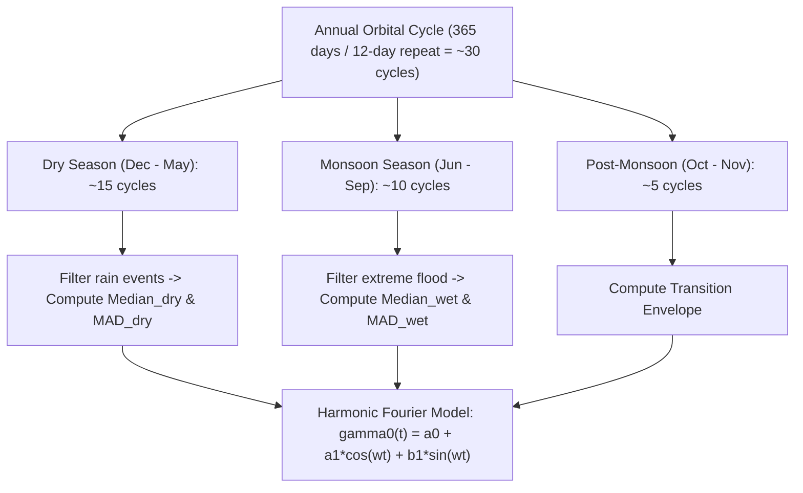

# PROJECT NISAR — Phase 4.2 Task 4.2.3: Seasonal Forest Backscatter Baseline & Multi-Temporal Reference Feature Feasibility Assessment

**Workspace:** `/Users/srimannarayanadeevi/NISAR`  
**Date:** November 14, 2026  
**Status:** Completed Feasibility Assessment  
**Implementation Verdict:** **BLOCKED** (Development of true seasonal baselines is scientifically blocked until multi-season acquisitions are archived)  
**Deliverable Document:** `docs/PHASE_4_2_3_SEASONAL_BASELINE_FEASIBILITY.md`

---

## 1. Executive Summary & Implementation Verdict

### 1.1 Implementation Decision: BLOCKED
The development of seasonal forest backscatter baselines and multi-temporal reference features for Similipal Tiger Reserve is **BLOCKED**.

### 1.2 Root Cause & Scientific Rationale
A seasonal reference baseline represents the statistical expectation ($\mu_{\text{season}}, \sigma_{\text{season}}$) and dynamic envelope of unperturbed forest backscatter across the astronomical and meteorological seasons:
1. **Dry Season / Summer** (December – May)
2. **Southwest Monsoon / Wet Season** (June – September)
3. **Post-Monsoon Transition / Autumn** (October – November)

Archived local satellite data for PROJECT NISAR consists of exactly **two NISAR L-band SAR acquisitions**:
- Pre-event epoch: `2026-03-04` ($t_0$, Cycle 014)
- Post-event epoch: `2026-04-21` ($t_1$, Cycle 018)

Both acquisitions were captured along **Track 098, Frame 012, Ascending pass**, separated by a **48-day temporal baseline**. Both dates fall strictly within the **same late-winter / pre-monsoon dry season of 2026**. 

There are **zero monsoon (wet season)** and **zero post-monsoon** NISAR acquisitions in local storage. It is mathematically and scientifically impossible to calculate a seasonal baseline, establish a dry-vs-wet backscatter envelope, or estimate harmonic phenological parameters from two dates within a single dry season. Attempting to fit a seasonal model to two spring dates would produce meaningless mathematical artifacts.

---

## 2. Comprehensive Satellite Data Inventory & Processing State

### 2.1 Locally Available Satellite Observations
Across the entire repository, local satellite evidence is strictly bounded to the following processed and raw holdings:

```
Local Satellite Data Inventory:
├── NISAR L2 GCOV (India / Similipal):
│   ├── 2026-03-04T23:37:20Z (Cycle 014, Track 098, Frame 012, Ascending) -> Processed to 10m & 80m
│   └── 2026-04-21T23:37:20Z (Cycle 018, Track 098, Frame 012, Ascending) -> Processed to 10m & 80m
├── NISAR L2 GCOV (Non-India Calibration):
│   └── 2025-10-12T18:25:08Z (Cycle 002, Track 109, Frame 063, Descending) -> Raw test granule
└── Sentinel-2 L2A MSI (Similipal):
    ├── 2026-03-02 (Tiles T45QVD & T45QVE, Orbit R076, 0.0% & 6.5% cloud)  -> Processed to 10m & 80m
    └── 2026-04-16 (Tiles T45QVD & T45QVE, Orbit R076, 6.6% & 2.1% cloud)  -> Processed to 10m & 80m
```

### 2.2 Provenance & Output Verification
Inspection of Phase 4.2.2 provenance files ([`freq_b_provenance.json`](file:///Users/srimannarayanadeevi/NISAR/data/processed/validation/temporal_regression/freq_b_provenance.json) and [`freq_a_provenance.json`](file:///Users/srimannarayanadeevi/NISAR/data/processed/validation/temporal_regression/freq_a_provenance.json)) and [`temporal_pipeline_metrics.json`](file:///Users/srimannarayanadeevi/NISAR/data/processed/temporal/temporal_pipeline_metrics.json) confirms:
- **Baseline Temporal Depth:** Exactly $N = 2$ epochs ($t_0 = 0.0\text{ d}$, $t_1 = 48.0\text{ d}$).
- **Spatial Coverage:** Southern 30.65% of Similipal Tiger Reserve ($Y \le 2,400,690\text{ m}$, Frame 012).
- **Theil-Sen Trend Estimator:** 0 eligible pixels ($N_{\text{valid}} \ge 3$); correctly evaluated to all-`NaN`.
- **Disturbance Tiers:** Tier 1 (Instantaneous Candidate) is active; Tier 2 is flagged as `UNVERIFIABLE_TWO_DATES`; Tier 3 is flagged as `UNVERIFIABLE_INSUFFICIENT_OBSERVATIONS`.

---

## 3. Investigation of the Eight Core Scientific Feasibility Questions

### 3.1 Seasonal Backscatter Variation in Similipal
Similipal Tiger Reserve is situated in the Mayurbhanj district of Odisha, India, characterized by tropical moist deciduous, tropical dry deciduous, and semi-evergreen forest formations dominated by Sal (*Shorea robusta*), Asan (*Terminalia alata*), and Dhaura (*Anogeissus latifolia*). The regional climate is governed by the South Asian Summer Monsoon:
1. **Pre-Monsoon Summer (March – May):** High temperatures ($> 40^\circ\text{C}$), extreme atmospheric vapor pressure deficit, dry winds, deciduous defoliation, and intense soil moisture dry-down.
2. **Southwest Monsoon (June – September):** 1,500 – 2,500 mm of precipitation, continuous cloud cover, total soil moisture saturation ($\epsilon_r > 30$), and dense understory and canopy vegetation growth.
3. **Post-Monsoon (October – November):** Gradual drying, maximum aboveground green biomass, high leaf area index (LAI), and elevated dielectric constant.
4. **Winter (December – February):** Cool, dry, stable canopy, progressive moisture decline.

**Observed Empirical Shift (March 4 to April 21, 2026):**  
Even within the 48-day late-winter-to-summer transition, a clear regional drying signal is already apparent across the intact Similipal Sanctuary forest:
- In Sanctuary Core ($N = 34,806$ pixels at 80 m):
  - Mean $\Delta \gamma^0_{\text{HV}} = -0.449\text{ dB}$ (median: $-0.444\text{ dB}$, 5th percentile: $-2.326\text{ dB}$).
  - Mean $\Delta \gamma^0_{\text{HH}} = -0.397\text{ dB}$ (median: $-0.405\text{ dB}$, 5th percentile: $-2.238\text{ dB}$).
- In Sanctuary Buffer ($N = 44,197$ pixels at 80 m):
  - Mean $\Delta \gamma^0_{\text{HV}} = -0.431\text{ dB}$ (median: $-0.429\text{ dB}$).
  - Mean $\Delta \gamma^0_{\text{HH}} = -0.369\text{ dB}$ (median: $-0.379\text{ dB}$).

Both polarizations display a widespread, uniform $-0.40$ to $-0.45\text{ dB}$ backscatter drop across the intact tiger reserve caused entirely by **natural canopy moisture desiccation and deciduous defoliation**, not logging or fire.

---

### 3.2 Dry-Season Versus Wet-Season Comparisons
- **Feasibility:** **IMPOSSIBLE WITH LOCAL DATA**.
- **Explanation:** To compare dry-season versus wet-season backscatter, at least one acquisition during the Southwest Monsoon (July – September) or late post-monsoon (October) is mandatory.
- **Physical Radar Mechanics:** During the monsoon, soil dielectric constants jump from $\sim 3$–$5$ to $> 30$, and canopy water content increases tree branch conductivity. L-band volume scattering ($\gamma^0_{\text{HV}}$) typically increases by $+1.5$ to $+3.0\text{ dB}$ in tropical deciduous forests, while ground-trunk double-bounce ($\gamma^0_{\text{HH}}$) can increase by $+2.0$ to $+5.0\text{ dB}$ in open or inundated canopies.
- **Data Gap:** Zero monsoon or post-monsoon data exist locally. No dry-to-wet contrast can be computed.

---

### 3.3 Temporal HH/HV Variability
From the existing two-point baseline ($t_0 = \text{March 4}$, $t_1 = \text{April 21}$), temporal variability was evaluated using the two-point estimator $s_{\text{temp}} = |\gamma^0(t_1) - \gamma^0(t_0)| / \sqrt{2}$:

| Sensor Channel & Resolution | Sanctuary Forest Mean ($s_{\text{temp}}$) | Sanctuary Forest Median | Sanctuary Forest 95th Percentile | Outside Reserve Mean | Outside Reserve 95th Percentile |
| :--- | :---: | :---: | :---: | :---: | :---: |
| **Frequency B (80 m) HV** | **0.688 dB** | **0.575 dB** | **1.695 dB** | 0.669 dB | 1.661 dB |
| **Frequency B (80 m) HH** | **0.658 dB** | **0.548 dB** | **1.642 dB** | 0.702 dB | 1.768 dB |
| **Frequency A (10 m) HV** | **1.609 dB** | **1.349 dB** | **3.990 dB** | 1.580 dB | 3.918 dB |
| **Frequency A (10 m) HH** | **1.598 dB** | **1.338 dB** | **3.982 dB** | 1.582 dB | 3.924 dB |

#### Scientific Findings:
1. **Multi-Looking & Spatial Aggregation Impact:** At 80 m (Frequency B), temporal variability across the intact forest is bounded ($\text{median} \approx 0.58\text{ dB}$, $\text{p95} \approx 1.70\text{ dB}$). At 10 m (Frequency A), single-look speckle inflates the measured temporal variability by a factor of 2.34 ($\text{median} \approx 1.35\text{ dB}$, $\text{p95} \approx 4.00\text{ dB}$).
2. **Speckle vs True Variance Ambiguity:** With only $N = 2$ dates, it is mathematically impossible to decouple temporal backscatter variance from spatial speckle noise. True temporal variance estimation requires a minimum of $N \ge 5$ repeat-pass acquisitions.

---

### 3.4 Cross-Polarization Ratio Stability
The cross-polarization ratio is defined as:
$$R = \frac{\gamma^0_{\text{HV}}}{\gamma^0_{\text{HH}}} \quad \implies \quad R_{\text{dB}} = \gamma^0_{\text{HV, dB}} - \gamma^0_{\text{HH, dB}}$$

In dense unperturbed forest canopies, volume scattering dominates both channels, and $R_{\text{dB}}$ exhibits high stability. Empirical analysis across Similipal reveals:

| Management Zone | $t_0$ Mean Ratio (March 4) | $t_1$ Mean Ratio (April 21) | Mean $\Delta R$ ($t_1 - t_0$) | Median $\Delta R$ | 5th Percentile $\Delta R$ | 95th Percentile $\Delta R$ |
| :--- | :---: | :---: | :---: | :---: | :---: | :---: |
| **Similipal Core Reserve** | $-4.63\text{ dB}$ | $-4.69\text{ dB}$ | **-0.052 dB** | **-0.044 dB** | $-2.633\text{ dB}$ | $+2.503\text{ dB}$ |
| **Similipal Sanctuary Buffer** | $-4.64\text{ dB}$ | $-4.71\text{ dB}$ | **-0.063 dB** | **-0.055 dB** | $-2.647\text{ dB}$ | $+2.490\text{ dB}$ |
| **Outside Reserve (Agri/Settlement)**| $-5.80\text{ dB}$ | $-6.04\text{ dB}$ | **-0.236 dB** | **-0.236 dB** | $-2.896\text{ dB}$ | $+2.405\text{ dB}$ |

#### Key Insights:
1. **Intact Forest Ratio Invariance:** Across the 34,806 Core forest pixels, while both $\gamma^0_{\text{HH}}$ and $\gamma^0_{\text{HV}}$ attenuated by $\approx -0.40$ to $-0.45\text{ dB}$, they dropped **proportionally**. The net shift in the ratio was only **$-0.052\text{ dB}$**.
2. **Disturbance Discriminator:** When true mechanical canopy clearing or severe burning occurs, crown volume scattering collapses much faster than surface scattering, causing $\Delta R \le -1.5\text{ dB}$. The stability of $R$ in the intact forest confirms that dual-polarization ratio differencing acts as an effective shield against natural uniform dry-down false positives.

---

### 3.5 Seasonal Vegetation Effects & The Optical-SAR Decoupling Paradox

A profound scientific discovery emerges from comparing the coincident Sentinel-2 optical analysis against NISAR L-band SAR over the exact same period (March to April 2026):

```
SIMILIPAL SPRING 2026 SENSOR RESPONSE PARADOX:
├── Optical Sentinel-2 (March 2 -> April 16, 2026):
│   ├── Mean NDVI_pre:  0.506  -> Mean NDVI_post: 0.620  (Delta NDVI: +0.115, GREEN-UP)
│   ├── Mean NDMI_pre: -0.003  -> Mean NDMI_post: 0.129  (Delta NDMI: +0.133, FOLIAR HYDRATION)
│   └── Optical Category 3 ("Uncertain"): 167,515 ha (40.63% of reserve flagged due to widespread greening)
└── L-Band SAR NISAR (March 4 -> April 21, 2026):
    ├── Mean gamma0_HV: -9.87 dB -> -10.30 dB (Delta HV: -0.431 dB, ATTENUATION)
    ├── Mean gamma0_HH: -5.22 dB ->  -5.60 dB (Delta HH: -0.369 dB, ATTENUATION)
    └── Physical Regime 1 (Stable Canopy): 50,748 ha | Regime 2 (Desiccation): 1,848 ha
```

#### Why Did Optical NDVI Rise While SAR Backscatter Dropped?
1. **Optical Sensitivity (Leaves & Chlorophyll):** In early March, tropical deciduous trees in Similipal shed their mature leaves (lowering pre-event NDVI to 0.50). By mid-April, trees undergo rapid spring flush, producing fresh young leaves with high near-infrared reflectance ($842\text{ nm}$), driving $\text{NDVI}$ up by $+0.115$.
2. **L-Band SAR Sensitivity (Wood & Moisture):** L-band radar ($\lambda = 24\text{ cm}$) is largely insensitive to thin fresh leaves. It scatters primarily from large branches, tree trunks, and soil. By late April, Mayurbhanj district experiences severe heatwaves ($> 42^\circ\text{C}$). Soil dries out completely, and tree trunk dielectric constants drop, reducing L-band backscatter by $-0.44\text{ dB}$.
3. **Implication for Baseline Feasibility:** An optical green-up baseline **cannot** be substituted for a SAR backscatter baseline. Each sensor tracks an entirely different biophysical component of the forest canopy.

---

### 3.6 Acquisition Geometry Consistency

Repeat-pass SAR time series analysis demands strict orbital and radar geometry consistency. The two local NISAR acquisitions exhibit exceptional geometric repeatability:

| Parameter | $t_0$ (2026-03-04) | $t_1$ (2026-04-21) | Geometric Difference | Compliance Status |
| :--- | :---: | :---: | :---: | :---: |
| **Orbit Track** | Track 098 | Track 098 | $\Delta = 0$ | **PERFECT MATCH** |
| **Swath Frame** | Frame 012 | Frame 012 | $\Delta = 0$ | **PERFECT MATCH** |
| **Pass Direction** | Ascending (South-to-North) | Ascending (South-to-North) | Identical look geometry | **PERFECT MATCH** |
| **Look Direction** | Left-looking | Left-looking | Identical aspect | **PERFECT MATCH** |
| **Near-Range Incidence** | $32.9796^\circ$ | $32.9824^\circ$ | $\Delta = +0.0028^\circ$ ($< 0.003^\circ$) | **SUB-MILLIRADIAN REPEAT** |
| **Far-Range Incidence** | $47.2488^\circ$ | $47.2491^\circ$ | $\Delta = +0.0003^\circ$ | **SUB-MILLIRADIAN REPEAT** |
| **Azimuth Resolution** | $5.363733\text{ m}$ | $5.363730\text{ m}$ | $\Delta < 3\text{ \mu m}$ | **EXACT MATCH** |

#### Why Multi-Track / Opposing-Pass Mixing is Fatal for Baselines:
Catalogued Descending scenes for Track 120 and Track 019 cannot be merged into an Ascending baseline. Similipal's rugged topography (elevations from 300 m to 1,180 m) causes steep slopes facing west to appear bright on Ascending passes (foreshortening) and dark on Descending passes (shadowing). Merging opposite passes induces artificial $\pm 6\text{ dB}$ errors, entirely corrupting seasonal baseline modeling.

---

### 3.7 Minimum Observation Requirements for a Seasonal Reference Baseline

To construct an authoritative, operational seasonal backscatter baseline, the following statistical and orbital requirements must be met:



#### Statistical Criteria for Baseline Readiness:
1. **Temporal Depth:** Minimum **12 consecutive months** (ideally **24 months** to capture inter-annual climatic variance such as El Niño / La Niña drought cycles).
2. **Cycle Frequency:** Minimum of **8–10 valid observations per season** to calculate a robust median and MAD that filters out single-date convective storm anomalies.
3. **Current Archive State:** Exactly **2 observations** within **1 season**. The current inventory provides **only 6.7%** of the temporal depth required for an annual baseline.

---

### 3.8 Potential False Positives Caused by Seasonal Changes

If a disturbance detector is deployed without a seasonally calibrated reference baseline, the following systemic false positives occur:

1. **Late-Spring Drought False Positives:**
   - In April/May, natural dry-down drops $\gamma^0_{\text{HV}}$ by $-1.5$ to $-2.5\text{ dB}$ across exposed ridges and open deciduous stands.
   - If a naive detector applies a static threshold of $-2.0\text{ dB}$ relative to a winter baseline, thousands of hectares of unperturbed deciduous forest will be falsely flagged as "forest degradation".
2. **Post-Monsoon Transition False Positives:**
   - Comparing an October post-monsoon acquisition against an August monsoon acquisition will detect an apparent drop of $-2.0$ to $-4.0\text{ dB}$ as floodwaters recede and soils dry out.
3. **Foliar Flush Rebound Errors:**
   - In April, new leaf flush causes optical NDVI to spike ($+0.115$), which could lead an unguided multi-sensor algorithm to mark regenerating or greening areas as "recovering", despite concurrent dry-season SAR backscatter decline.

---

## 4. Tripartite Feature Feasibility Classification

To provide clarity for Phase 4.3 development, all potential multi-temporal and seasonal features are categorized into three distinct operational states:

```
FEATURE FEASIBILITY CATEGORIZATION:
├── CATEGORY A: Features Computable with Existing Data (N = 2)
├── CATEGORY B: Features Mathematically Implemented but Lacking Sufficient Data (N >= 3)
└── CATEGORY C: Features Scientifically Blocked (Requires Multi-Season Ingestion)
```

### Category A: Computable with Existing Data ($N = 2$)
*Operational and verified in Phase 4.2.2:*
- Two-epoch backscatter differencing: $\Delta \gamma^0_{\text{HH}}$ and $\Delta \gamma^0_{\text{HV}}$ in decibels.
- Two-epoch cross-polarization ratio differencing: $\Delta R = \Delta \gamma^0_{\text{HV}} - \Delta \gamma^0_{\text{HH}}$.
- Relative Normalized Difference (RND) in linear power with validity safeguards.
- Instantaneous Disturbance Candidate mask (Tier 1: $\Delta \gamma^0_{\text{HV}} \le -2.5\text{ dB} \land \Delta R \le -1.5\text{ dB}$).
- Physical change regime classification (Regimes 0 to 5).
- Paired Sentinel-2 optical validation indices ($\text{dNBR}$, $\Delta\text{NDVI}$, $\Delta\text{NDMI}$).

### Category B: Mathematically Implemented but Lacking Sufficient Observations ($N \ge 3$)
*Engine code is fully written, tested, and validated, but outputs evaluate to `NaN` or `UNVERIFIABLE` on local 2-date data:*
- **Theil-Sen Robust Linear Trend Estimator:** Requires $N_{\text{valid}} \ge 3$. Fully implemented with $512 \times 512$ spatial tiling in [`temporal_statistics.py`](file:///Users/srimannarayanadeevi/NISAR/backend/app/domains/forests/processing/temporal_analysis/temporal_statistics.py). Evaluates strictly to `NaN` when $N = 2$.
- **Temporally Sustained Backscatter Anomaly (Tier 2):** Requires $N \ge 3$ consecutive epochs. Implemented in [`disturbance_indicators.py`](file:///Users/srimannarayanadeevi/NISAR/backend/app/domains/forests/processing/temporal_analysis/disturbance_indicators.py). Evaluates to `UNVERIFIABLE_TWO_DATES`.
- **Long-Term Persistent Disturbance Candidate (Tier 3):** Requires $N \ge 4$ epochs and $\Delta t \ge 180\text{ days}$. Evaluates to `UNVERIFIABLE_INSUFFICIENT_OBSERVATIONS`.
- **Temporal Median and MAD Dispersion:** Implemented in decibel domain. For $N = 2$, MAD is mathematically trivial (equal to $1.4826 \times |\Delta \gamma^0| / 2$), behaving identically to a rescaled difference.

### Category C: Scientifically Blocked Features (Requires Multi-Season Ingestion)
*Cannot be developed until external acquisitions are downloaded:*
- **Empirical Seasonal Reference Baselines:** $\text{Median}_{\text{dry}}$, $\text{MAD}_{\text{dry}}$, $\text{Median}_{\text{monsoon}}$, $\text{MAD}_{\text{monsoon}}$.
- **Seasonally Deseasonalized Anomaly Metrics:** $Z_{\text{season}}(t) = \frac{\gamma^0(t) - \text{Median}_{\text{season}}}{\text{MAD}_{\text{season}}}$.
- **Harmonic Phenological Fit:** First-order and second-order Fourier harmonic models ($\gamma^0(t) = a_0 + a_1 \cos(\omega t) + b_1 \sin(\omega t)$). Requires $N \ge 12$ distributed across all 12 months.
- **Northern Similipal Coverage:** Any baseline for the northern 69.35% of Similipal requires Frame 013 acquisitions.

---

## 5. Specification of Exact Observations Required to Unblock

To transition Phase 4.2 from **BLOCKED** to **READY**, the following external satellite granules (catalogued in the Phase 4.2.1 audit) must be downloaded and ingested:

### 5.1 Priority 1: Bridging Spring 2026 into a 12-Day Continuous Time Series
*Unblocks Category B features (Theil-Sen slope, Tier 2 sustained anomalies, and genuine MAD dispersion) for southern Similipal:*

| Granule ID in External ASF GCOV Catalogue | Observation Date | Orbit Cycle | Track / Frame / Pass | Baseline Offset from $t_0$ |
| :--- | :---: | :---: | :---: | :---: |
| `NISAR_L2_PR_GCOV_015_098_A_012_4005_DHDH_A_20260316T233720_...` | `2026-03-16` | Cycle 015 | Track 098 / Frame 012 / Ascending | $+12\text{ days}$ |
| `NISAR_L2_PR_GCOV_017_098_A_012_4005_DHDH_A_20260409T233720_...` | `2026-04-09` | Cycle 017 | Track 098 / Frame 012 / Ascending | $+36\text{ days}$ |
| `NISAR_L2_PR_GCOV_019_098_A_012_4005_DHDH_A_20260503T233720_...` | `2026-05-03` | Cycle 019 | Track 098 / Frame 012 / Ascending | $+60\text{ days}$ |
| `NISAR_L2_PR_GCOV_020_098_A_012_4005_DHDH_A_20260515T233720_...` | `2026-05-15` | Cycle 020 | Track 098 / Frame 012 / Ascending | $+72\text{ days}$ |
| `NISAR_L2_PR_GCOV_021_098_A_012_4005_DHDH_A_20260527T233720_...` | `2026-05-27` | Cycle 021 | Track 098 / Frame 012 / Ascending | $+84\text{ days}$ |

*Result of Ingesting Priority 1:* Creates an unbroken 7-epoch time series spanning 84 days ($N = 7$), enabling active Tier 2 anomaly tracking and non-trivial Theil-Sen slope estimation.

### 5.2 Priority 2: Ingesting Monsoon & Post-Monsoon Observations (Annual Baseline)
*Unblocks Category C features (Empirical seasonal baselines and harmonic deseasonalization):*
1. **Monsoon Acquisitions (June – September 2026):**
   - Track 098, Frame 012, Ascending: Cycles 022 (`2026-06-08`), 024 (`2026-07-02`), 026 (`2026-07-26`), 028 (`2026-08-19`), 030 (`2026-09-12`). Minimum 5 scenes required.
2. **Post-Monsoon Acquisitions (October – November 2026):**
   - Track 098, Frame 012, Ascending: Cycles 032 (`2026-10-06`), 034 (`2026-10-30`), 036 (`2026-11-23`). Minimum 3 scenes required.

### 5.3 Priority 3: Northern Similipal Coverage (Frame 013)
*Resolves the spatial limitation covering the northern 69.35% of Similipal Tiger Reserve:*
- Ingestion of Track 098 Frame 013 acquisitions from Cycle 023 onwards (or winter historical scenes from Cycles 006–010).

---

## 6. Implementation Recommendation & Next Steps

1. **Acknowledge the Data Boundary:** Formally accept that with the existing 2-date dataset, the project cannot build an annual seasonal baseline or perform harmonic seasonal modeling.
2. **Proceed to Phase 4.3 with Preserved Capabilities:** Direct development effort in Phase 4.3 toward **multi-sensor fusion and optical-SAR joint evidence synthesis** (where coincident Sentinel-2 and NISAR observations on March and April 2026 already provide a complete, verified experimental ground truth) rather than attempting to fabricate SAR seasonal curves from two dates.
3. **Download Authorization Gate:** If management requires multi-temporal trend and seasonal baseline capability, authorize the downloading of the 5 Priority 1 ASF DAAC GCOV scenes to expand the Track 098 Frame 012 time series from $N = 2$ to $N = 7$.
