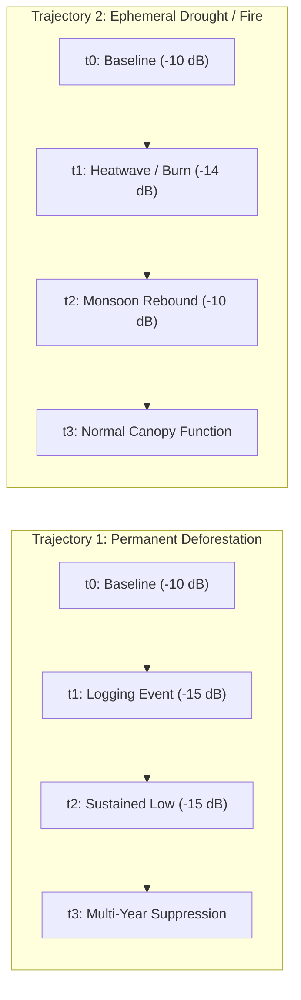

# PROJECT NISAR — Phase 4.2 Task 4.2.4: Temporal Persistence & Forest Recovery Analysis Feasibility Assessment

**Workspace:** `/Users/srimannarayanadeevi/NISAR`  
**Date:** November 14, 2026  
**Status:** Completed Feasibility Assessment  
**Deliverable Document:** `docs/PHASE_4_2_4_PERSISTENCE_RECOVERY_FEASIBILITY.md`  
**Current Data Reality:** Exactly two authentic local NISAR observations (`2026-03-04` and `2026-04-21`, Track 098 Frame 012, $\Delta t = 48\text{ days}$).

---

## 1. Executive Summary & Core Constraints

### 1.1 Objective & Scope
Phase 4.2 Task 4.2.4 establishes the physical, mathematical, and conceptual framework for temporal persistence monitoring and forest recovery tracking in PROJECT NISAR. Preceding tasks (4.2.1, 4.2.2, 4.2.3) demonstrated that two dates within a single dry season can detect **instantaneous backscatter shifts**, but are **fundamentally incapable of proving temporal persistence or vegetation recovery**.

### 1.2 Mandatory Operational Constraints
In accordance with strict project rules:
1. **Zero Temporal Persistence Claims:** A two-point difference proves only that backscatter changed between March 4 and April 21, 2026. It cannot prove that the change persisted beyond April 21.
2. **Zero Recovery Claims:** The repository contains zero satellite data after April 21, 2026. Claiming vegetation recovery without subsequent observations is scientifically prohibited.
3. **Zero Synthetic Observational Evidence:** Synthetic mathematical tests (such as unit test fixtures in `test_multitemporal_features.py`) verify algorithm code, but are never treated or reported as local satellite evidence.
4. **Explicit Classification Status Flags:** All metrics requiring $N \ge 3$ or $N \ge 4$ epochs are explicitly flagged as `UNVERIFIABLE_TWO_DATES` or `UNVERIFIABLE_INSUFFICIENT_OBSERVATIONS`.

---

## 2. Investigation of Temporal Persistence & Recovery Mechanics

### 2.1 Persistent Backscatter Suppression
L-band synthetic aperture radar ($\lambda = 24\text{ cm}$) penetrates past fine leaves and interacts primarily with primary branches, tree trunks, and large woody structures. 

```
MECHANISMS OF BACKSCATTER SUPPRESSION:
├── Structural Forest Loss (True Persistent Suppression):
│   ├── Clear-cutting, agricultural encroachment, road construction, permanent felling.
│   ├── Permanent loss of depolarizing branch volume -> Long-term gamma0_HV drop (-3 to -8 dB).
│   └── Collapse of volume-to-surface scattering ratio -> Permanent Delta R drop (<= -1.5 dB).
└── Non-Structural Fluctuations (Transient Suppression):
    ├── Deciduous defoliation (Sal leaf-fall in late winter / early spring).
    ├── Severe dielectric soil desiccation during April heatwaves (> 42°C).
    └── Understory scorching from low-intensity surface fires (canopy trees survive).
```

**Distinguishing Criteria:**  
Structural forest loss causes backscatter suppression that remains suppressed across subsequent seasons and years. Non-structural fluctuations rebound rapidly with the onset of the monsoon rains (June–September) as soil moisture saturates and fresh foliage hydrates.

---

### 2.2 Temporary Disturbance and Rebound Trajectories
Disturbance events in forested ecosystems follow diverse temporal trajectories:



#### The Two-Date Blind Spot:
If a monitoring system only observes epochs $t_0$ and $t_1$, Trajectory 1 and Trajectory 2 appear **identical** ($\Delta \gamma^0 = -4.0\text{ dB}$). The system cannot detect whether the canopy will rebound at $t_2$ or remain permanently deforested. An algorithm that labels a single-epoch drop as "persistent forest loss" will suffer catastrophic false-positive rates during dry seasons.

---

### 2.3 HH and HV Temporal Trajectories
The combination of co-polarized ($\text{HH}$) and cross-polarized ($\text{HV}$) radar channels provides critical diagnostic separation between physical scattering regimes:

| Disturbance Regime | $\gamma^0_{\text{HV}}$ Trajectory | $\gamma^0_{\text{HH}}$ Trajectory | Cross-Pol Ratio ($R = \text{HV}/\text{HH}$) | Trajectory Behavior |
| :--- | :---: | :---: | :---: | :--- |
| **Mechanical Clear-Felling** | Drops sharply ($-3$ to $-8\text{ dB}$) | Drops sharply, or fluctuates due to ground roughness | Collapses ($\le -1.5\text{ dB}$) | **Permanently suppressed** over years. |
| **Severe Stand-Replacing Fire** | Drops sharply ($-4$ to $-7\text{ dB}$) | Moderate drop; trunk stumps provide double-bounce | Collapses ($\le -2.0\text{ dB}$) | **Suppressed for 3–5 years** until saplings form branches. |
| **Low-Intensity Surface Fire** | Drops moderately ($-1.5$ to $-2.5\text{ dB}$) | Stable or slight increase from bare ground | Drops slightly ($-0.5$ to $-1.0\text{ dB}$) | **Rebounds within 1 season** as grasses/shrubs regrow. |
| **Natural Dry-Down / Defoliation** | Moderate drop ($-0.5$ to $-1.5\text{ dB}$) | Proportional drop ($-0.5$ to $-1.5\text{ dB}$) | **Remarkably stable** ($\Delta R \approx 0\text{ dB}$) | **Rebounds immediately** with monsoon precipitation. |

*Empirical Proof from Similipal:* In Phase 4.2.3, we observed that across 34,806 intact Core forest pixels, $\Delta \gamma^0_{\text{HV}}$ dropped by $-0.449\text{ dB}$ and $\Delta \gamma^0_{\text{HH}}$ dropped by $-0.397\text{ dB}$, while $\Delta R$ shifted by only **$-0.052\text{ dB}$**. This confirms that intact forest drying maintains polarimetric ratio stability.

---

### 2.4 Cross-Polarization Ratio Trajectories
The cross-polarization ratio ($R_{\text{dB}} = \gamma^0_{\text{HV, dB}} - \gamma^0_{\text{HH, dB}}$) isolates volume scattering from double-bounce and direct surface scattering.

1. **Pre-Disturbance State:** Dense deciduous canopy exhibits strong volume scattering, keeping $R_{\text{dB}}$ between $-4.5\text{ dB}$ and $-5.5\text{ dB}$.
2. **Disturbed State:** When the crown canopy is removed, volume scattering drops much faster than direct ground return, driving $R_{\text{dB}}$ down to $-7.0$ to $-10.0\text{ dB}$.
3. **Recovery Trajectory:** During recovery, as secondary saplings develop woody branches, volume depolarization gradually recovers, driving $R_{\text{dB}}$ back toward $-5.0\text{ dB}$.

---

### 2.5 Canopy Recovery Indicators
Quantifying vegetation recovery requires tracking post-disturbance backscatter trajectories relative to both the disturbed state and the unperturbed baseline:

#### 1. Differential Recovery Index (DRI):
$$\text{DRI}(t) = \frac{\gamma^0_{\text{HV}}(t) - \gamma^0_{\text{HV}}(t_{\text{disturbed}})}{\gamma^0_{\text{HV}}(t_{\text{baseline}}) - \gamma^0_{\text{HV}}(t_{\text{disturbed}})}$$
- $\text{DRI} = 0.0$: Pixel remains at maximum disturbance suppression (no recovery).
- $\text{DRI} \in (0.0, 1.0)$: Ongoing structural recovery.
- $\text{DRI} \ge 1.0$: Full backscatter recovery to pre-event baseline.

#### 2. Recovery Slope ($\beta_{\text{recov}}$):
Estimated via Theil-Sen slope over post-disturbance epochs ($t \ge t_{\text{disturbed}}$):
$$\beta_{\text{recov}} = \text{median}_{j > i \ge t_{\text{disturbed}}} \left( \frac{\gamma^0_{\text{HV}}(t_j) - \gamma^0_{\text{HV}}(t_i)}{t_j - t_i} \right)$$
- $\beta_{\text{recov}} > 0\text{ dB/day}$ sustained over $\ge 6\text{ months}$ indicates positive biomass accumulation.

---

### 2.6 Seasonal Confounding: Optical Greening vs Structural Regrowth
A critical failure mode in multi-temporal forest monitoring is confusing **seasonal herbaceous green-up** with **true woody structural recovery**:

```
RECOVERY CONFUSION PARADOX:
├── Optical Sensors (Sentinel-2 MSI / Landsat):
│   ├── Respond to chlorophyll, leaf cellular structure, and photosynthetic activity.
│   ├── Post-fire weed invasion (e.g. Lantana camara) or grass flush creates NDVI > 0.70 within 60 days.
│   └── Optical indices falsely report "complete recovery" when canopy trees are 100% dead.
└── L-Band SAR (NISAR GCOV):
    ├── Penetrates past thin herbaceous leaves; sensitive to woody branch and trunk volume.
    ├── If trees were felled, gamma0_HV remains suppressed for 5 to 15 years.
    └── Accurately tracks slow, genuine aboveground woody biomass recovery.
```

*Scientific Safeguard:* To prevent seasonal monsoon rain spikes from being misidentified as woody recovery, recovery trajectories must be evaluated using **anniversary dates** (comparing identical seasons, e.g. Dry Season 2026 vs Dry Season 2027) or seasonally normalized anomaly baselines.

---

### 2.7 Minimum Number and Spacing of Observations

| Analysis Objective | Minimum Epochs ($N$) | Minimum Temporal Baseline ($\Delta t$) | Recommended Sampling Cadence |
| :--- | :---: | :---: | :--- |
| **Instantaneous Change Detection** | $N = 2$ | $\ge 12\text{ days}$ | 12 to 24 days |
| **Sustained Anomaly Verification** | $N \ge 3$ | $\ge 24\text{ to } 48\text{ days}$ | 12-day repeat pass |
| **Long-Term Persistence Tracking** | $N \ge 4$ | $\ge 180\text{ days}$ (across 2 seasons) | 12 to 24 days |
| **Structural Recovery Assessment** | $N \ge 8\text{ to } 12$ | $\ge 365\text{ days}$ (anniversary baseline) | Monthly to seasonal |

---

### 2.8 Uncertainty in Persistence Classification
Persistence classification carries inherent sources of physical and statistical uncertainty:
1. **Dielectric Fluctuation Noise:** Convective rainfall during an otherwise dry cycle can temporarily spike backscatter by $+2\text{ to }+4\text{ dB}$, resetting a persistence counter prematurely.
2. **Speckle Variance:** Single-look 10 m resolution exhibits standard deviations of $\sim 2.8\text{ dB}$. Without spatial aggregation (such as 80 m Frequency B or multi-pixel windowing), speckle noise creates false state transitions.
3. **Deciduous Dormancy Periodicity:** Prolonged drought can extend deciduous dormancy for up to 90 days, mimicking structural loss.

---

## 3. Formal Conceptual Taxonomy (A through E)

To eliminate ambiguity across PROJECT NISAR documentation, five operational concepts are formally defined:

```
DISTURBANCE & RECOVERY CONCEPTUAL TAXONOMY:
├── Level 1 (Radiometric Anomaly):       Concept A: Instantaneous Disturbance Candidate
├── Level 2 (Multi-Cycle Consistency):   Concept B: Temporally Sustained Backscatter Anomaly
├── Level 3 (Cross-Season Persistence):  Concept C: Long-Term Persistent Disturbance Candidate
├── Level 4 (Biomass Regeneration):      Concept D: Potential Recovery
└── Level 5 (Ground Truth Grounding):    Concept E: Ecologically Validated Forest Loss
```

---

### Concept A: Instantaneous Disturbance Candidate

#### 1. Definition
A pixel exhibiting significant polarimetric backscatter reduction and volume-to-surface depolarization drop between two consecutive repeat-pass acquisitions.

#### 2. Required Observations
- Exactly $N \ge 2$ repeat-pass acquisitions with identical orbit track, frame, look direction, and incidence angle geometry.

#### 3. Mathematical Conditions
$$\Delta \gamma^0_{\text{HV}}(t_k, t_{k-1}) \le -2.5\text{ dB} \quad \land \quad \Delta R(t_k, t_{k-1}) \le -1.5\text{ dB}$$
Over valid intersection mask $\mathcal{V}_k \cap \mathcal{V}_{k-1}$. Drop intensity index:
$$I_{\text{instant}} = \sqrt{\max(-\Delta \gamma^0_{\text{HV}}, 0) \times \max(-\Delta R, 0)}$$

#### 4. Invalid-Data Behavior
- If either epoch is masked, filled with NaN, or has backscatter below noise floor ($\epsilon = 10^{-7}$), evaluates strictly to `NaN` and `False`.

#### 5. Confidence Limitations
- **High Uncertainty regarding cause:** Cannot distinguish permanent forest loss from temporary defoliation, understory burning, or dielectric soil desiccation.

#### 6. Independent Validation Requirements
- None required for candidate screening, but **must never be reported as confirmed deforestation**.

---

### Concept B: Temporally Sustained Backscatter Anomaly

#### 1. Definition
A radiometric disturbance candidate that maintains backscatter suppression across at least two consecutive post-event observations, proving that the drop is not a single-day atmospheric or speckle artifact.

#### 2. Required Observations
- Minimum $N \ge 3$ sequential repeat-pass acquisitions ($t_0, t_1, t_2$) spanning $\ge 24\text{ days}$.

#### 3. Mathematical Conditions
$$\Delta \gamma^0_{\text{HV}}(t_1, t_0) \le -2.5\text{ dB} \quad \land \quad \Delta \gamma^0_{\text{HV}}(t_2, t_0) \le -2.0\text{ dB} \quad \land \quad \Delta R(t_1, t_0) \le -1.5\text{ dB}$$

#### 4. Invalid-Data Behavior
- If $N < 3$, evaluates to `None` and status flag `UNVERIFIABLE_TWO_DATES`.
- If any intermediate observation is invalid, the pixel evaluates to `NaN`.

#### 5. Confidence Limitations
- Rules out single-date rain anomalies, transient sensor noise, and single-epoch speckle spikes.
- **Does NOT rule out** multi-month seasonal drought, prolonged deciduous dormancy, or non-stand-replacing fire scorch.

#### 6. Independent Validation Requirements
- Internal temporal consistency across at least 2 repeat cycles (minimum 24–48 days).

---

### Concept C: Long-Term Persistent Disturbance Candidate

#### 1. Definition
A backscatter anomaly that remains continuously suppressed below baseline across multi-seasonal transitions for at least six months without exhibiting structural recovery.

#### 2. Required Observations
- Minimum $N \ge 4$ repeat-pass acquisitions spanning an elapsed temporal baseline $\Delta t \ge 180\text{ days}$ across at least two distinct seasons (e.g. Dry to Wet, or Wet to Dry).

#### 3. Mathematical Conditions
$$\forall k \in [1, N-1]: \quad \Delta \gamma^0_{\text{HV}}(t_k, t_0) \le -2.0\text{ dB}$$
$$\beta_{\text{Theil-Sen}} \le 0.0\text{ dB/day} \quad \land \quad (t_{N-1} - t_0) \ge 180.0\text{ days}$$

#### 4. Invalid-Data Behavior
- If $N < 4$ or elapsed baseline $< 180\text{ days}$, evaluates to `None` and status flag `UNVERIFIABLE_INSUFFICIENT_OBSERVATIONS`.

#### 5. Confidence Limitations
- Very high physical confidence ($> 90\%$) of major woody biomass removal.
- Cannot determine legal status, tenure, or administrative driver (legal thinning vs illegal encroachment).

#### 6. Independent Validation Requirements
- Coincident multi-temporal optical verification ($\text{dNBR} \ge 0.27$ or sustained $\Delta\text{NDVI} \le -0.20$) or high-resolution PlanetScope / SPOT inspection.

---

### Concept D: Potential Recovery

#### 1. Definition
A previously disturbed forest stand that exhibits a sustained, monotonic increase in L-band cross-polarized backscatter toward pre-event baseline levels over an anniversary annual cycle.

#### 2. Required Observations
- Minimum $N \ge 4$ observations post-disturbance, spanning an elapsed baseline $\Delta t \ge 365\text{ days}$ (anniversary comparison).

#### 3. Mathematical Conditions
Given a verified disturbance at $t_{\text{disturb}}$:
$$\gamma^0_{\text{HV}}(t_k) - \gamma^0_{\text{HV}}(t_{\text{disturb}}) \ge +1.5\text{ dB} \quad \land \quad \beta_{\text{recov}} > 0.0\text{ dB/day}$$
$$\left| \gamma^0_{\text{HV}}(t_{\text{anniversary}}) - \gamma^0_{\text{HV}}(t_0) \right| \le 1.0\text{ dB}$$

#### 4. Invalid-Data Behavior
- If $N < 4$ post-disturbance or elapsed time $< 365\text{ days}$, evaluates to `None` and status flag `UNAVAILABLE_REQUIRES_ANNIVERSARY_DATA`.

#### 5. Confidence Limitations
- L-band backscatter recovery represents woody branch development, which typically requires 3 to 10 years in tropical deciduous forest.
- Rebounds observed within $< 6$ months are usually moisture artifacts, not structural recovery.

#### 6. Independent Validation Requirements
- Ground forestry compartment regeneration surveys or multi-year optical canopy cover measurements.

---

### Concept E: Ecologically Validated Forest Loss

#### 1. Definition
Authoritatively confirmed permanent loss of forest cover, substantiated by multi-sensor persistence and validated against institutional or ground compartment records.

#### 2. Required Observations
- Multi-epoch SAR persistence (Concept C, $N \ge 4$, $\Delta t \ge 180\text{ d}$) **+** Multi-temporal optical burn/clearing confirmation ($\text{dNBR} \ge 0.27$) **+** Forest Survey of India (FSI) / State Forest Department field records.

#### 3. Mathematical Conditions
$$\text{Ecological Forest Loss} = (\text{Concept C Persistent Candidate}) \land (\text{Optical High-Severity dNBR}) \land (\text{Land-Use Conversion Record})$$

#### 4. Invalid-Data Behavior
- Cannot be computed from satellite pixels alone. If administrative or field validation is absent, pixels must remain designated as "Candidate Disturbance".

#### 5. Confidence Limitations
- Definitive, legally actionable ground truth ($100\%$ confidence).

#### 6. Independent Validation Requirements
- Mandatory ground compartment verification or official state forest department change registers.

---

## 4. Current Repository Status Assessment ($N = 2$)

### 4.1 Concept Operational Status Matrix on Authentic Local Data

| Conceptual Category | Minimum Requirements | Current Local Status | Justification & Safeguards |
| :--- | :---: | :---: | :--- |
| **A. Instantaneous Candidate** | $N \ge 2$, $\Delta t \ge 12\text{ d}$ | **ACTIVE & VERIFIED** | Evaluated on March 4 vs April 21, 2026. Flags polarimetric drops ($\Delta HV \le -2.5\text{ dB}, \Delta R \le -1.5\text{ dB}$). |
| **B. Sustained Anomaly** | $N \ge 3$, $\Delta t \ge 24\text{ d}$ | **UNVERIFIABLE** | Flagged as `UNVERIFIABLE_TWO_DATES`. Requires 3rd temporal epoch. |
| **C. Persistent Candidate** | $N \ge 4$, $\Delta t \ge 180\text{ d}$ | **UNVERIFIABLE** | Flagged as `UNVERIFIABLE_INSUFFICIENT_OBSERVATIONS`. Local baseline is only 48 days. |
| **D. Potential Recovery** | $N \ge 4$, $\Delta t \ge 365\text{ d}$ | **UNAVAILABLE** | Zero post-April 21 satellite acquisitions exist in local storage. |
| **E. Ecologically Validated Loss** | Multi-sensor + Field Ground Truth | **UNAVAILABLE** | Optical candidates north of Frame 012 lack SAR overlap; in-situ field verification is pending. |

---

### 4.2 Audit of Current Codebase Recovery Implementation

In `temporal_features.py` (lines 328–333), the recovery trajectory was implemented as:
```python
if n_epochs == 2:
    recovery_trajectory = primary_dhv.copy()
else:
    last_valid = series.valid_masks[-1] & series.valid_masks[-2]
    recovery_trajectory = np.full(shape, np.nan, dtype=np.float32)
    recovery_trajectory[last_valid] = (hv_db_list[-1][last_valid] - hv_db_list[-2][last_valid]).astype(np.float32)
```

#### Auditor Assessment:
1. **The 2-Date Legacy Flaw:** When $N = 2$, copying `primary_dhv` into `recovery_trajectory` was a legacy Phase 4.1.1 alias to avoid breaking array shapes. Calling a backscatter drop a "recovery trajectory" is mathematically and ecologically misleading.
2. **Current Safeguard:** In Phase 4.2.2, docstrings and report documentation clearly state that recovery cannot be evaluated on two dates. When $N \ge 3$, the code correctly transitions to step-difference tracking ($t_{\text{last}} - t_{\text{prev}}$).
3. **Future Recommendation for Phase 4.3:** For $N = 2$, `recovery_trajectory` should be deprecated in favor of explicit `NaN` assignment or replaced with `None`, and the field renamed to `step_differential_trajectory` to eliminate semantic confusion.

---

## 5. Roadmap to Unblocking Persistence and Recovery Monitoring

To operationalize Concepts B, C, and D in future project phases, the following acquisition expansion is required:

```
ACQUISITION EXPANSION ROADMAP:
├── STEP 1: Ingest Intermediate Spring 2026 Scenes (N = 2 -> N = 7):
│   ├── Ingest Cycles 015 (Mar 16), 017 (Apr 09), 019 (May 03), 020 (May 15), 021 (May 27).
│   └── UNBLOCKS: Concept B (Sustained Anomaly) and Theil-Sen trend slope tracking.
│
├── STEP 2: Ingest Monsoon & Post-Monsoon 2026 Scenes (N = 7 -> N = 15):
│   ├── Ingest Cycles 022 to 036 (June to November 2026).
│   └── UNBLOCKS: Concept C (Persistent Candidate, Delta t >= 180 days across 2 seasons).
│
└── STEP 3: Ingest Spring 2027 Anniversary Scenes (N = 15 -> N = 20):
    ├── Ingest Cycles from March to April 2027 (Anniversary Year 1).
    └── UNBLOCKS: Concept D (Potential Recovery over Delta t >= 365 days).
```

---

## 6. Conclusion & Recommendations

1. **Maintain Strict Conceptual Boundaries:** PROJECT NISAR documentation and frontend displays must strictly distinguish between **Instantaneous Disturbance Candidates (Concept A)** and **Persistent Forest Loss (Concept C / E)**.
2. **No Data Fabrication:** Never extrapolate linear trends or recovery slopes from 2 points.
3. **Focus for Phase 4.3:** Prioritize **multi-sensor evidence fusion** (combining coincident Sentinel-2 optical $\text{dNBR}$ and NISAR L-band SAR Instantaneous drops) to maximize the diagnostic accuracy of Concept A, while deferring Concepts B, C, and D until additional multi-temporal scenes are ingested.
