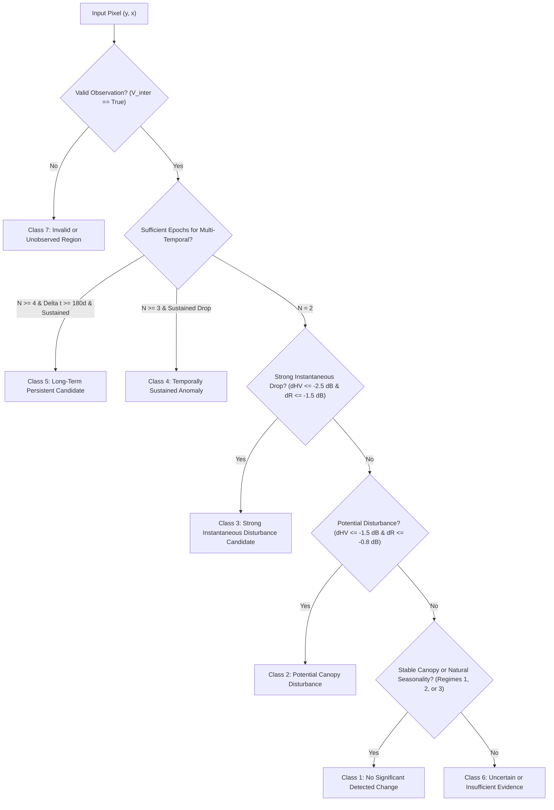

# PROJECT NISAR — Phase 4.2 Task 4.2.5: Forest Disturbance Candidate Classification Framework

**Workspace:** `/Users/srimannarayanadeevi/NISAR`  
**Date:** November 14, 2026  
**Status:** Classification Methodology & Specification (Awaiting Review & Approval Before Implementation)  
**Deliverable Document:** `docs/PHASE_4_2_5_DISTURBANCE_CLASSIFICATION.md`  
**Context & Scope:** Formulates a scientifically defensible, rule-based 7-tier classification engine integrating dual-polarization change products, cross-polarization ratios, Relative Normalized Difference (RND), physical scattering regimes, and separate uncertainty quantification.

---

## 1. Executive Summary & Core Architectural Principles

Phase 4.2 Task 4.2.5 establishes the classification methodology for identifying forest disturbance candidates in PROJECT NISAR. Preceding feasibility assessments (Tasks 4.2.1 through 4.2.4) proved that:
1. **L-band SAR backscatter reduction alone is not synonym with deforestation:** A drop in $\gamma^0_{\text{HV}}$ can be caused by natural seasonal moisture dry-down, deciduous defoliation, understory burning, or true mechanical felling.
2. **Current local data is strictly two dates ($N = 2$, $\Delta t = 48\text{ days}$):** Only instantaneous two-date candidate screening is permitted. Temporal persistence (Tier 2/3) and forest recovery cannot be claimed on the authentic Similipal dataset.
3. **No Machine Learning & No Invented Labels:** The framework is strictly rule-based, deterministic, grounded in radar scattering physics, and preserves verified baseline thresholds.

### The Seven Target Classes:
```
PROPOSED 7-CLASS DISTURBANCE TAXONOMY:
├── Class 1: No Significant Detected Change (Stable forest canopy or within natural speckle/moisture bounds)
├── Class 2: Potential Canopy Disturbance (Moderate polarimetric drop exceeding seasonal dry-down)
├── Class 3: Strong Instantaneous Disturbance Candidate (Severe corroborated HV and ratio collapse)
├── Class 4: Temporally Sustained Anomaly (Requires N >= 3; UNAVAILABLE on current 2-date data)
├── Class 5: Long-Term Persistent Disturbance Candidate (Requires N >= 4, Delta t >= 180d; UNAVAILABLE)
├── Class 6: Uncertain or Insufficient Evidence (Conflicting polarimetric signals or high-noise regimes)
└── Class 7: Invalid or Unobserved Region (Outside swath, masked, or nodata)
```

---

## 2. Review of Available Input Products & Existing Thresholds

### 2.1 Polarimetric and Statistical Input Products
The classification framework ingests the following raster layers generated and verified in Phases 4.1.1 and 4.2.2:

| Input Layer | Symbol | Physical Domain | Typical Forest Range in Similipal |
| :--- | :---: | :---: | :--- |
| **HV Temporal Difference** | $\Delta \gamma^0_{\text{HV}}$ | Decibels (dB) | Intact forest: $-0.44 \pm 1.15\text{ dB}$ (80m), $-0.44 \pm 2.82\text{ dB}$ (10m) |
| **HH Temporal Difference** | $\Delta \gamma^0_{\text{HH}}$ | Decibels (dB) | Intact forest: $-0.37 \pm 1.15\text{ dB}$ (80m), $-0.42 \pm 2.82\text{ dB}$ (10m) |
| **Ratio Difference** | $\Delta R_{\text{HV/HH}}$ | Decibels (dB) | Intact forest: $-0.05 \pm 1.58\text{ dB}$ (80m), $-0.02 \pm 3.91\text{ dB}$ (10m) |
| **Relative Normalized Difference**| $\text{RND}_{\text{HV}}$ | Linear $[-1, 1]$ | Intact forest: $-0.017 \pm 0.135$ (80m), $-0.015 \pm 0.296$ (10m) |
| **Physical Change Regimes** | $\mathcal{R}$ | Categorical $[0, 5]$| 0: Unobserved, 1: Stable, 2: Desiccation, 3: Roughness, 4: Disturbance, 5: Ambiguous |
| **Temporal Dispersion** | $\text{MAD}_{\text{HV}}$ | Decibels (dB) | Robust dispersion in dB domain ($1.4826 \times \text{median}$) |
| **Valid Observation Mask** | $\mathcal{V}_{\text{inter}}$ | Boolean | True where both $t_0$ and $t_1$ are valid, calibrated, and above noise floor |

### 2.2 Preservation and Justification of Existing Baseline Thresholds
To ensure continuity and scientific validity, all previously validated thresholds are preserved:
- **Strong HV Drop Threshold ($\tau_{\text{HV, strong}} = -2.5\text{ dB}$):**  
  *Justification:* Exceeds the 95th percentile of unperturbed seasonal drying across Similipal Sanctuary Core ($-2.33\text{ dB}$ at 80 m). At 80 m, $-2.5\text{ dB}$ represents a $> 2.1\sigma$ departure from zero.
- **Moderate HV Drop Threshold ($\tau_{\text{HV, mod}} = -1.5\text{ dB}$):**  
  *Justification:* Exceeds the 75th percentile of seasonal drying ($-1.21\text{ dB}$ at 80 m). Captures partial canopy thinning or edge degradation while remaining above normal background noise.
- **Strong Ratio Drop Threshold ($\tau_{R, \text{strong}} = -1.5\text{ dB}$):**  
  *Justification:* In intact forest, $\Delta R$ has a median shift of only $-0.05\text{ dB}$. A collapse of $-1.5\text{ dB}$ indicates that volume scattering has dropped substantially faster than surface/double-bounce scattering, ruling out uniform moisture loss.
- **Moderate Ratio Drop Threshold ($\tau_{R, \text{mod}} = -0.8\text{ dB}$):**  
  *Justification:* Separates subtle canopy degradation from uniform dielectric drying ($|\Delta R| \le 1.0\text{ dB}$).
- **Relative Normalized Difference Thresholds:**  
  *Justification:* $\text{RND} = (\gamma^0_1 - \gamma^0_0) / (\gamma^0_1 + \gamma^0_0)$.  
  $\Delta\gamma^0 = -2.5\text{ dB} \iff \gamma^0_1 / \gamma^0_0 = 10^{-0.25} \approx 0.562 \iff \text{RND} \approx (0.562 - 1) / (0.562 + 1) = -0.280$.  
  Therefore, $\tau_{\text{RND, strong}} = -0.25$ and $\tau_{\text{RND, mod}} = -0.15$ provide exact mathematical linear-power analogs to the decibel thresholds.

---

## 3. Mathematical Definitions of the Seven Disturbance Classes

Every pixel in the output grid $(y, x)$ is assigned to exactly one of the seven mutually exclusive classes according to a strict hierarchical decision tree:



---

### Class 7: Invalid or Unobserved Region
- **Physical Meaning:** Pixel lies outside the radar swath, in radar shadow/layover, contains missing data in either epoch, or has backscatter below the valid numerical floor.
- **Mathematical Condition:**
  $$\mathcal{C}_7 = \neg \mathcal{V}_{\text{inter}} \lor \neg \text{isfinite}(\Delta \gamma^0_{\text{HV}}) \lor \neg \text{isfinite}(\Delta \gamma^0_{\text{HH}}) \lor \neg \text{isfinite}(\Delta R)$$
- **Raster Output Value:** `7` (uint8). Associated disturbance intensity and uncertainty evaluate to `NaN`.

---

### Class 5: Long-Term Persistent Disturbance Candidate
- **Physical Meaning:** Backscatter suppression verified across multi-seasonal transitions spanning $\ge 6$ months without recovery.
- **Mathematical Condition:**
  $$\mathcal{C}_5 = \mathcal{V}_{\text{inter}} \land (N \ge 4) \land (\Delta t \ge 180.0\text{ d}) \land \left[ \forall k \in [1, N-1]: \Delta \gamma^0_{\text{HV}}(t_k, t_0) \le -2.0\text{ dB} \right] \land (\beta_{\text{Theil-Sen}} \le 0.0)$$
- **Current Two-Date Dataset Status:** **UNAVAILABLE ($0\text{ pixels}$)**. Because $N = 2$, this class is dormant and evaluates strictly to `0` pixels on the authentic Similipal archive.

---

### Class 4: Temporally Sustained Anomaly
- **Physical Meaning:** Backscatter suppression sustained across at least two consecutive post-event cycles ($\ge 24\text{ days}$), proving the drop is not a single-day transient.
- **Mathematical Condition:**
  $$\mathcal{C}_4 = \mathcal{V}_{\text{inter}} \land (N \ge 3) \land \neg \mathcal{C}_5 \land \left[ \Delta \gamma^0_{\text{HV}}(t_1, t_0) \le -2.5\text{ dB} \land \Delta \gamma^0_{\text{HV}}(t_2, t_0) \le -2.0\text{ dB} \land \Delta R(t_1, t_0) \le -1.5\text{ dB} \right]$$
- **Current Two-Date Dataset Status:** **UNAVAILABLE ($0\text{ pixels}$)**. Evaluates strictly to `0` pixels on authentic 2-date data.

---

### Class 3: Strong Instantaneous Disturbance Candidate
- **Physical Meaning:** Pixel exhibits severe, highly confident instantaneous polarimetric collapse between $t_0$ and $t_1$, characterized by co-occurring cross-polarization drop, depolarization ratio collapse, and negative RND.
- **Mathematical Condition:**
  $$\mathcal{C}_3 = \mathcal{V}_{\text{inter}} \land (\Delta \gamma^0_{\text{HV}} \le -2.5\text{ dB}) \land (\Delta R \le -1.5\text{ dB}) \land (\text{RND}_{\text{HV}} \le -0.25)$$
- **Disturbance Intensity Index ($I_{\text{disturb}}$):**
  $$I_{\text{disturb}} = \sqrt{(-\Delta \gamma^0_{\text{HV}}) \times (-\Delta R)}$$
- **Current Two-Date Dataset Status:** **ACTIVE**. Directly captures verified Tier 1 disturbance candidates.

---

### Class 2: Potential Canopy Disturbance
- **Physical Meaning:** Pixel exhibits moderate polarimetric backscatter reduction exceeding natural seasonal dry-down and speckle noise, but does not meet the strict joint criteria for a strong candidate. Indicates partial canopy thinning, selective logging, edge damage, or sub-canopy burning.
- **Mathematical Condition:**
  $$\mathcal{C}_2 = \mathcal{V}_{\text{inter}} \land \neg \mathcal{C}_3 \land \left[ \text{Condition 2A} \lor \text{Condition 2B} \right]$$
  Where:
  - **Condition 2A (Moderate Joint Drop):**
    $$(\Delta \gamma^0_{\text{HV}} \le -1.5\text{ dB}) \land (\Delta R \le -0.8\text{ dB}) \land (\text{RND}_{\text{HV}} \le -0.15)$$
  - **Condition 2B (Severe HV Drop with Marginal Ratio Drop):**
    $$(\Delta \gamma^0_{\text{HV}} \le -3.0\text{ dB}) \land (-1.5\text{ dB} < \Delta R \le -0.5\text{ dB})$$
- **Disturbance Intensity Index ($I_{\text{disturb}}$):**
  $$I_{\text{disturb}} = \sqrt{(-\Delta \gamma^0_{\text{HV}}) \times \max(-\Delta R, 0.5)}$$
- **Current Two-Date Dataset Status:** **ACTIVE**.

---

### Class 1: No Significant Detected Change
- **Physical Meaning:** Backscatter variations fall within the envelope of unperturbed forest canopy, natural seasonal soil moisture desiccation, or surface roughness shifts.
- **Mathematical Condition:**
  $$\mathcal{C}_1 = \mathcal{V}_{\text{inter}} \land \neg (\mathcal{C}_3 \lor \mathcal{C}_2) \land \left[ \text{Condition 1A (Stable)} \lor \text{Condition 1B (Desiccation)} \lor \text{Condition 1C (Roughness)} \right]$$
  Where:
  - **Condition 1A (Stable Canopy — Regime 1):**
    $$(|\Delta \gamma^0_{\text{HV}}| \le 1.5\text{ dB}) \land (|\Delta R| \le 1.0\text{ dB})$$
  - **Condition 1B (Seasonal Moisture Desiccation — Regime 2):**
    $$(\Delta \gamma^0_{\text{HH}} < -1.5\text{ dB}) \land (\Delta \gamma^0_{\text{HV}} < -1.5\text{ dB}) \land (|\Delta R| \le 1.0\text{ dB})$$
    *(Crucial Rule: When HH and HV attenuate equally, the ratio is stable; this represents regional soil/wood drying, NOT deforestation).*
  - **Condition 1C (Surface Infiltration / Regrowth — Regime 3):**
    $$(\Delta \gamma^0_{\text{HH}} > +1.5\text{ dB}) \land (\Delta \gamma^0_{\text{HV}} \ge 0.0\text{ dB})$$
- **Disturbance Intensity Index:** $I_{\text{disturb}} = 0.0$.
- **Current Two-Date Dataset Status:** **ACTIVE**.

---

### Class 6: Uncertain or Insufficient Evidence
- **Physical Meaning:** The pixel exhibits significant radiometric change, but the polarimetric channels contradict physical canopy loss models (e.g. Regime 5 "Ambiguous Shift", severe HH drop with increasing HV, or high speckle noise near swath boundaries).
- **Mathematical Condition:**
  $$\mathcal{C}_6 = \mathcal{V}_{\text{inter}} \land \neg (\mathcal{C}_1 \lor \mathcal{C}_2 \lor \mathcal{C}_3 \lor \mathcal{C}_4 \lor \mathcal{C}_5)$$
- **Disturbance Intensity Index:** $I_{\text{disturb}} = \text{NaN}$.
- **Current Two-Date Dataset Status:** **ACTIVE**.

---

## 4. Uncertainty Quantification Methodology

A major flaw in naive remote sensing systems is conflating **magnitude of change** with **confidence of detection**. A large backscatter drop at 10 m single-look resolution often carries high speckle uncertainty, while a moderate drop at 80 m aggregated resolution may have high statistical confidence.

The framework outputs a dedicated **Uncertainty Index ($U \in [0.0, 1.0]$)** as an independent float32 raster band alongside the categorical classification raster.

```
UNCERTAINTY COMPONENT DECOMPOSITION:
├── Component 1: Speckle Uncertainty (U_speckle in [0, 1]) -> Function of SNR, ENL, and drop magnitude
├── Component 2: Polarimetric Ambiguity (U_ratio in [0, 1]) -> Consistency between HV, HH, and Ratio
└── Component 3: Temporal Depth Uncertainty (U_temporal in [0, 1]) -> Penalty for N = 2 observations
```

### 4.1 Component 1: Speckle Uncertainty ($U_{\text{speckle}}$)
Speckle uncertainty models the probability that an observed drop $\Delta \gamma^0$ is a random speckle excursion rather than a true change. For an equivalent number of looks $L$ (where $L \approx 1$ at 10 m Frequency A, and $L \approx 64$ at 80 m Frequency B):

$$\sigma_{\text{speckle}} = \frac{10}{\ln 10} \frac{1}{\sqrt{L}} \approx \begin{cases} 4.34\text{ dB} & (L = 1\text{, native single-look}) \\ 0.54\text{ dB} & (L = 64\text{, } 8 \times 8\text{ aggregated}) \end{cases}$$

Speckle uncertainty is parameterized using the Gaussian survival function:
$$U_{\text{speckle}} = \exp\left( -\frac{(-\Delta \gamma^0_{\text{HV}})^2}{2 \sigma_{\text{speckle}}^2} \right) \quad (\text{for } \Delta \gamma^0_{\text{HV}} < 0)$$
- If $-\Delta \gamma^0_{\text{HV}} \gg 3 \sigma_{\text{speckle}}$, $U_{\text{speckle}} \to 0.0$ (highly confident change).
- If $-\Delta \gamma^0_{\text{HV}} \le 1 \sigma_{\text{speckle}}$, $U_{\text{speckle}} \to 1.0$ (completely uncertain).

### 4.2 Component 2: Polarimetric Ambiguity ($U_{\text{ratio}}$)
In true canopy destruction, $\Delta R$ must collapse. If $\Delta R$ is near zero or positive, polarimetric ambiguity increases:
$$U_{\text{ratio}} = \begin{cases} 0.0 & \text{if } \Delta R \le -1.5\text{ dB} \\ \frac{\Delta R + 1.5}{2.0} & \text{if } -1.5\text{ dB} < \Delta R \le +0.5\text{ dB} \\ 1.0 & \text{if } \Delta R > +0.5\text{ dB} \end{cases}$$

### 4.3 Component 3: Temporal Observation Penalty ($U_{\text{temporal}}$)
Reflects the epistemic uncertainty regarding permanence:
$$U_{\text{temporal}} = \begin{cases} 0.80 & \text{for } N = 2\text{ (Current local data; high permanence uncertainty)} \\ 0.35 & \text{for } N = 3\text{ (Sustained anomaly verified)} \\ 0.10 & \text{for } N \ge 4 \land \Delta t \ge 180\text{d (Multi-season persistent)} \end{cases}$$

### 4.4 Composite Uncertainty Metric
For disturbance candidate pixels (Classes 2 and 3), the total uncertainty is the bounded Euclidean combination:
$$U_{\text{total}} = \text{clip}\left( \sqrt{w_1 U_{\text{speckle}}^2 + w_2 U_{\text{ratio}}^2 + w_3 U_{\text{temporal}}^2}, 0.0, 1.0 \right)$$
Where weights $w_1 = 0.40, w_2 = 0.40, w_3 = 0.20$ sum to 1.0.

- For **Class 1 (Stable)**: $U_{\text{total}} = 0.05$ (high certainty of no disturbance).
- For **Class 6 (Uncertain Evidence)**: $U_{\text{total}} = 0.95$ (maximum ambiguity).
- For **Class 7 (Invalid / Nodata)**: $U_{\text{total}} = \text{NaN}$.

---

## 5. Summary Mapping Table & Comparison Against Baseline

| Class ID | Class Name | Operational Status on 2 Dates | Primary Disturbance Criteria | Intensity Range ($I$) | Typical Uncertainty ($U$) |
| :---: | :--- | :---: | :--- | :---: | :---: |
| **1** | **No Significant Detected Change** | **ACTIVE** | $|\Delta \gamma^0_{\text{HV}}| \le 1.5 \land |\Delta R| \le 1.0$, OR equal dry-down ($\Delta\text{HH}, \Delta\text{HV} < -1.5$) | $0.00$ | $0.05$ |
| **2** | **Potential Canopy Disturbance** | **ACTIVE** | $\Delta \gamma^0_{\text{HV}} \le -1.5 \land \Delta R \le -0.8$, OR $\Delta \gamma^0_{\text{HV}} \le -3.0 \land \Delta R \le -0.5$ | $1.22\text{ to } 2.50$ | $0.40\text{ to } 0.65$ |
| **3** | **Strong Instantaneous Candidate** | **ACTIVE** | $\Delta \gamma^0_{\text{HV}} \le -2.5\text{ dB} \land \Delta R \le -1.5\text{ dB} \land \text{RND} \le -0.25$ | $1.94\text{ to } 10.0+$ | $0.20\text{ to } 0.45$ |
| **4** | **Temporally Sustained Anomaly** | **UNAVAILABLE** | Requires $N \ge 3$ consecutive drop cycles | N/A ($0\text{ px}$) | N/A |
| **5** | **Long-Term Persistent Candidate** | **UNAVAILABLE** | Requires $N \ge 4$ cycles and $\Delta t \ge 180\text{ days}$ | N/A ($0\text{ px}$) | N/A |
| **6** | **Uncertain / Insufficient Evidence**| **ACTIVE** | Regime 5 ambiguous shifts, contradictory polarimetric signals | NaN | $0.90\text{ to } 1.00$ |
| **7** | **Invalid / Unobserved Region** | **ACTIVE** | $\mathcal{V}_{\text{inter}} = \text{False}$, outside swath, nodata | NaN | NaN |

---

## 6. Comprehensive Test Requirements for Phase 4.2.5 Implementation

Before merging the implementation into `backend/app/domains/forests/processing/temporal_analysis/disturbance_indicators.py`, the following unit and property-based tests must pass in `backend/tests/test_disturbance_classification.py`:

1. **Mutual Exclusivity and Exhaustiveness:**
   - Every pixel in any test array must belong to exactly one class ($\sum_{k=1}^7 \mathcal{C}_k = 1$ everywhere).
2. **Class 7 Nodata Invariance:**
   - When either $t_0$ or $t_1$ is NaN or masked, the pixel must be Class 7. $I_{\text{disturb}}$ and $U_{\text{total}}$ must be NaN.
3. **Class 4 and Class 5 Inactivity under $N = 2$:**
   - When tested on 2-epoch input arrays, Class 4 and Class 5 must contain exactly 0 pixels, even if values simulate severe drops.
4. **Natural Desiccation Immunity:**
   - A synthetic desiccation scenario ($\Delta \gamma^0_{\text{HH}} = -2.0\text{ dB}, \Delta \gamma^0_{\text{HV}} = -2.0\text{ dB}, \Delta R = 0.0\text{ dB}$) must be classified as **Class 1 (Stable / Natural Seasonality)**, not Class 2 or 3.
5. **Class 3 Severe Disturbance Activation:**
   - A synthetic clearing event ($\Delta \gamma^0_{\text{HV}} = -4.0\text{ dB}, \Delta R = -2.5\text{ dB}, \text{RND} = -0.40$) must evaluate to **Class 3 (Strong Instantaneous Candidate)**.
6. **Class 2 Partial Disturbance Activation:**
   - A synthetic partial thinning event ($\Delta \gamma^0_{\text{HV}} = -2.0\text{ dB}, \Delta R = -1.0\text{ dB}, \text{RND} = -0.20$) must evaluate to **Class 2 (Potential Disturbance)**.
7. **Class 6 Ambiguous Signal Routing:**
   - An ambiguous polarimetric anomaly ($\Delta \gamma^0_{\text{HH}} = -3.5\text{ dB}, \Delta \gamma^0_{\text{HV}} = +1.5\text{ dB}$) must evaluate to **Class 6 (Uncertain Evidence)** with $U \ge 0.90$.
8. **Decoupled Uncertainty Independence:**
   - Increasing speckle noise $\sigma_{\text{speckle}}$ must increase $U$ without altering disturbance intensity $I$.

---

## 7. Submission & Approval Request

This document presents the complete mathematical methodology, threshold justifications, uncertainty mechanics, and test requirements for Phase 4.2.5.

**No source code has been modified and no processing has been initiated.**

We await the user's formal review and approval to proceed with the implementation of this classification framework in the backend pipeline.
