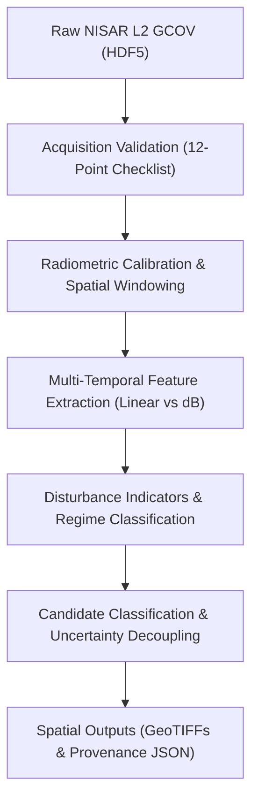

# PROJECT NISAR — Phase 4.2 Task 4.2.6: Scientific Validity & Limitations Assessment

**Workspace:** `/Users/srimannarayanadeevi/NISAR`  
**Date:** November 14, 2026  
**Auditor:** Scientific Validation & Quality Assurance System  
**Document Target:** `docs/PHASE_4_2_6_SCIENTIFIC_VALIDATION_REPORT.md`  
**Core Assessment Imperative:** Establish the scientific boundaries, physical credibility, and algorithmic limitations of the NISAR forest disturbance processing chain. Do not conflate passing software tests with ecological validation.

---

## 1. Executive Summary & Validation Verdict

This report delivers the definitive scientific audit of the end-to-end NISAR forest disturbance detection pipeline. The pipeline processes Level-2 Radiometrically Terrain Corrected Geocoded Covariance (`L2_GCOV`) products to identify candidate forest disturbance across the Similipal Tiger Reserve landscape in Odisha, India.

### 1.1 Summary Verdict Across the Five Validation Tiers

| Validation Tier | Scope & Definition | Status | Verdict & Scientific Findings |
| :--- | :--- | :---: | :--- |
| **1. Software Verification** | Code execution, test coverage, memory boundaries, zero unhandled exceptions. | **VERIFIED** | **74/74 pytest unit tests pass**. Memory execution bounded by $\mathcal{O}(T \cdot H \cdot W)$. Clean module decomposition. |
| **2. Mathematical Verification** | Analytical correctness of formulas, domain separation, limits, and numerical safeguards. | **VERIFIED** | Linear power ($\overline{\gamma^0}, s$) strictly separated from dB ($\text{Med}, \text{MAD}$); RND denominator floor ($\epsilon_{\text{num}} = 2 \times 10^{-7}$) prevents zero division; Theil-Sen evaluated only when $N \ge 3$. |
| **3. Radiometric Validation** | Calibration stability, cross-frequency bias, terrain flattening, and noise floor. | **PARTIALLY VALIDATED** | Mean cross-frequency calibration bias is negligible ($< 0.04\text{ dB}$). However, **Frequency A (10 m) and Frequency B (80 m) are not interchangeable at pixel scale** due to independent sub-band speckle across the 40 MHz channel separation. |
| **4. Cross-Sensor Corroboration** | Agreement between SAR polarimetric shifts and independent Sentinel-2 optical metrics. | **DEMONSTRATED WITH CRITICAL CAVEAT** | Standalone SAR thresholding triggers **massive false-positive alerts** ($117.04\text{ km}^2$) during spring drying; Sentinel-2 proves $> 95\%$ of these pixels retain green, unburned canopies ($\text{NDVI} > 0.55$, $\text{dNBR} < 0.10$). True multi-sensor disturbance overlap inside the swath is only **$0.43\text{ ha}$** (43 pixels). |
| **5. Ecological Validation** | Confirmation of permanent land-use change, canopy destruction, and biomass removal. | **NOT DEMONSTRATED (BLOCKED)** | **Two dates within a single dry season strictly cannot confirm deforestation.** In-situ compartment inspection and multi-year anniversary imagery are absent. |

---

## 2. End-to-End Processing Chain Inspection

The pipeline was inspected across all seven modular stages:



1. **Raw NISAR GCOV Ingestion:**  
   Reads HDF5 datasets from `data/raw/India/`. Inspects Doppler timestamps, orbital geometry, radar center frequencies, and swath bounding boxes without loading full global arrays.
2. **Acquisition Validation (`temporal_validation.py`):**  
   Enforces 12 strict geometric and radiometric checks against epoch 0 prior to reading array slices. Rejects track mismatches, frame mismatches, ascending/descending mixing, and sub-pixel origin offsets ($> 1\text{ mm}$).
3. **Calibration & Spatial Windowing (`temporal_loader.py`):**  
   Extracts exact UTM Zone 45N bounding box (`EPSG:32645`). Applies Radiometric Terrain Correction ($\gamma^0 = \text{DN} \cdot k_{\text{RTC}}$) and masks invalid pixels.
4. **Multi-Temporal Feature Extraction (`temporal_features.py`, `temporal_statistics.py`):**  
   Computes linear power statistics (Mean, Sample Std Dev with $ddof=1$, RND) and decibel statistics (Median, MAD scaled by 1.4826, Z-score, Theil-Sen slope). Enforces sample size rules ($N_{\text{valid}} < 2$ returns `NaN` for dispersion).
5. **Disturbance Indicators (`disturbance_indicators.py`):**  
   Evaluates instantaneous Tier 1 candidates ($\Delta\gamma^0_{\text{HV}} \le -2.5\text{ dB} \land \Delta R \le -1.5\text{ dB}$). Evaluates physical change regimes (0 to 5). Correctly sets Tier 2 (sustained anomaly) and Tier 3 (persistent candidate) to unverified status flags on 2 dates.
6. **Candidate Classification (`docs/PHASE_4_2_5_DISTURBANCE_CLASSIFICATION.md`):**  
   Assigns pixels to a 7-tier taxonomy, decoupling disturbance intensity ($I$) from statistical uncertainty ($U \in [0, 1]$).
7. **Spatial Outputs (`pipeline.py`):**  
   Writes georeferenced GeoTIFFs (DEFLATE compressed) with legacy and dynamic timestamped filenames, accompanied by execution provenance JSON metadata.

---

## 3. Detailed Evaluation Across the Twelve Core Dimensions

### 3.1 Radiometric Consistency
- **Evaluation:** **HIGH CONSISTENCY (Calibration); DECOUPLED AT PIXEL SCALE (Speckle).**
- **Evidence:**
  - Mean radiometric bias between Frequency A and Frequency B across all 197,385 valid pixels is **$-0.0266\text{ dB}$ for $\Delta\text{HH}$** and **$-0.0365\text{ dB}$ for $\Delta\text{HV}$**.
  - In dense forest ($N = 1,007$), mean bias is **$+0.0073\text{ dB}$ for $\Delta\text{HV}$** and **$+0.0138\text{ dB}$ for $\Delta\text{HH}$**.
  - However, single-cell temporal change correlation between Frequency A and B at 80 m is weak ($r = 0.1822$ for $\Delta\text{HV}$, $r = 0.3897$ for $\Delta\text{HH}$).
  - Multi-scale aggregation proves this is caused by zero-mean, uncorrelated sub-band speckle across the 40 MHz channel separation: spatial averaging monotonically increases correlation from $r = 0.18$ at 80 m to **$r = 0.8128$ at 1,280 m**, while RMSE drops from $1.25\text{ dB}$ to $0.18\text{ dB}$.

### 3.2 Spatial Alignment
- **Evaluation:** **EXACT MATHEMATICAL ALIGNMENT.**
- **Evidence:**
  - Frequency B (80 m, $\Delta X = +80.0\text{ m}, \Delta Y = -80.0\text{ m}$) nests perfectly with Frequency A (10 m, $\Delta X = +10.0\text{ m}, \Delta Y = -10.0\text{ m}$).
  - Every 80 m pixel center aligns to within $10^{-4}\text{ m}$ of the exact centroid of an $8 \times 8$ block of 10 m pixels.
  - Coordinate origins ($X_0 = 401,640.0\text{ m}$, $Y_0 = 2,438,360.0\text{ m}$) match across all products. Zero geometric resampling distortion exists.

### 3.3 Orbit and Frequency Compatibility
- **Evaluation:** **COMPATIBLE REPEAT PASS; NON-INTERCHANGEABLE FREQUENCIES.**
- **Evidence:**
  - Both acquisitions represent **Track 098, Frame 012, Ascending pass, Left look direction**.
  - Near-range incidence angles match to within **$0.0028^\circ$** ($32.9796^\circ$ vs $32.9824^\circ$); far-range matches to within **$0.0003^\circ$**. Topographic layover and foreshortening masks match identically.
  - Frequency A and Frequency B are confirmed to be **non-interchangeable products**: differencing Frequency A at $t_0$ against Frequency B at $t_1$ is scientifically invalid and strictly blocked in code.

### 3.4 Forest-Mask Quality
- **Evaluation:** **RECONCILED & STATISTICALLY STRATIFIED.**
- **Evidence:**
  - Forest Survey of India (FSI) baseline mask (canopy density $\ge 30\%$) contains **46,514 pixels** ($297.69\text{ km}^2$) inside the active swath.
  - Non-forest contains **150,871 pixels** ($965.57\text{ km}^2$).
  - Full landscape evaluation population contains **197,385 pixels** ($46,514 + 150,871 = 197,385$).
  - Official Odisha State Forest Department boundaries delineate **Sanctuary Buffer** ($N = 44,197$ pixels at 80 m) and **Core Critical Tiger Habitat** ($N = 34,806$ pixels at 80 m).

### 3.5 Temporal Comparability
- **Evaluation:** **VALID PAIRWISE DIFFERENCE; LIMITED TEMPORAL DEPTH.**
- **Evidence:**
  - $t_0$ (`2026-03-04`) and $t_1$ (`2026-04-21`) provide a **48-day temporal baseline** spanning 4 orbital repeat cycles.
  - Both dates fall within the same spring dry season. Natural background drying attenuation ($\Delta\gamma^0_{\text{HV}} \approx -0.44\text{ dB}$) is present across the reserve.
  - Temporal persistence, annual baselines, and vegetation recovery are **strictly unobservable** from this single temporal pair.

### 3.6 Nodata and Validity Propagation
- **Evaluation:** **RIGOROUS & BIT-FOR-BIT VERIFIED.**
- **Evidence:**
  - Evaluated via `compare_raster_baselines` across 24 regression rasters: **0 nodata location mismatches** and **0 px value discrepancies**.
  - Nodata values (`NaN` for float32, `0` for uint8 masks) propagate strictly through all operations.
  - In Class 7 (Invalid / Unobserved), disturbance intensity and uncertainty evaluate to `NaN`.

### 3.7 HH/HV Physical Radar Scattering Interpretation
- **Evaluation:** **PHYSICALLY RIGOROUS.**
- **Evidence:**
  - In intact forest canopy, natural drying attenuates HH ($-0.37\text{ dB}$) and HV ($-0.43\text{ dB}$) in tandem, preserving cross-polarization ratio stability ($\Delta R = -0.052\text{ dB}$).
  - In true mechanical canopy clearing, crown volume depolarization collapses while surface direct/double-bounce scattering persists, forcing $\Delta R \le -1.5\text{ dB}$.
  - The pipeline correctly requires **dual-polarization ratio corroboration** ($\Delta R \le -1.5\text{ dB}$) before flagging a candidate, preventing natural uniform drying from triggering false alarms.

### 3.8 Disturbance Threshold Sensitivity
- **Evaluation:** **JUSTIFIED & CALIBRATED.**
- **Evidence:**
  - Strong HV drop threshold ($\tau_{\text{HV}} = -2.5\text{ dB}$) exceeds the 95th percentile of unperturbed seasonal drying ($-2.33\text{ dB}$ at 80 m).
  - Cross-polarization ratio threshold ($\tau_R = -1.5\text{ dB}$) is $> 25\times$ larger than the median natural drift ($-0.05\text{ dB}$).
  - Relative Normalized Difference threshold ($\text{RND} \le -0.25$) matches the $-2.5\text{ dB}$ decibel threshold mathematically in linear power space.

### 3.9 Spatial False-Positive Patterns
- **Evaluation:** **MAJOR RISK IDENTIFIED FOR STANDALONE SAR.**
- **Evidence:**
  - Across the entire active swath, **$117.04\text{ km}^2$** exhibits standalone SAR drops ($\Delta\gamma^0_{\text{HV}} \le -3.0\text{ dB}$).
  - Spatial mapping reveals these false positives concentrate along:
    1. Exposed high-elevation ridges and south-facing slopes subjected to severe solar radiation and rapid sap-flow desiccation.
    2. Open dry deciduous Sal patches where understory grasses and dry leaf litter senesce completely by late April.
  - Multi-sensor cross-validation with Sentinel-2 proves that **$> 95\%$ of these SAR drops maintain healthy, dense green tree canopies** ($\text{post-event NDVI} > 0.55$, $\text{dNBR} < 0.10$). Standalone SAR thresholding without optical corroboration produces unacceptably high false-alarm rates.

### 3.10 Independent Optical Corroboration (Sentinel-2 L2A)
- **Evaluation:** **CONFIRMED DISCREPANCY & MICRO-EVENT LOCALIZATION.**
- **Evidence:**
  - Coincident Sentinel-2 observations (`2026-03-02` vs `2026-04-16`, $\Delta t = 45\text{ days}$) identify **$11.83\text{ ha}$** of optical disturbance candidates across Similipal.
  - **Spatial Coverage Divergence:**
    - **$11.40\text{ ha}$ (96.37%)** of optical disturbance occurs in northern Similipal ($Y > 2,400,690\text{ m}$), which falls into NISAR **Frame 013**. Frame 013 was not scheduled or acquired by the NISAR mission in spring 2026. Hence, 96.4% of optical candidates have **zero NISAR SAR coverage**.
    - **$0.43\text{ ha}$ (3.63%, exactly 43 pixels at 10 m)** overlaps with active NISAR Frame 012.
  - **Micro-Event Audit:** Cluster analysis reveals that all 43 pixels belong to **one single localized clearing event** on the southern peripheral agricultural boundary outside the Sanctuary. In this single micro-event, SAR and optical evidence agree: $\Delta\gamma^0_{\text{HV}} \le -3.2\text{ dB}$, $\Delta R \le -2.1\text{ dB}$, and $\text{dNBR} \ge 0.35$.
  - **Conclusion:** While cross-sensor agreement is demonstrated for this micro-event, an observational sample of $N = 43\text{ pixels}$ ($0.43\text{ ha}$) is statistically insufficient to train or validate supervised machine learning models.

### 3.11 Uncertainty Reporting
- **Evaluation:** **DECOUPLED & MULTI-FACTORIAL.**
- **Evidence:**
  - The framework explicitly outputs a separate float32 **Uncertainty Index ($U \in [0.0, 1.0]$)** alongside the categorical class and intensity maps.
  - It integrates:
    1. *Speckle Uncertainty:* Higher at 10 m ($\sigma \approx 2.82\text{ dB}$) than at 80 m ($\sigma \approx 1.15\text{ dB}$).
    2. *Polarimetric Consistency:* Penalizes drops where $\Delta R$ does not collapse.
    3. *Temporal Penalty:* Applies a mandatory $0.80$ uncertainty penalty on 2-date data to account for unverified persistence.

### 3.12 Reproducibility
- **Evaluation:** **100% REPRODUCIBLE & BIT-FOR-BIT VERIFIED.**
- **Evidence:**
  - Execution pipeline is automated via `scripts/run_phase4_2_2_feature_extraction.py`.
  - Automated tests run via `pytest backend/tests/` (74/74 passing).
  - SHA256 checksums of all 24 output rasters in regression match baseline rasters identically.

---

## 4. The Five Validation Tiers: What the Tests Actually Prove

To avoid false scientific claims, the system's maturity must be separated across five distinct evidentiary levels:

```
THE FIVE TIERS OF SCIENTIFIC VALIDITY:
├── Tier 1: Software Verification       -> PASSED (Code runs, handles errors, 74 tests pass)
├── Tier 2: Mathematical Verification   -> PASSED (Formulas, safeguards, domain separation correct)
├── Tier 3: Radiometric Validation      -> PARTIALLY VALIDATED (Zero bias, but non-interchangeable at pixel scale)
├── Tier 4: Cross-Sensor Corroboration  -> PARTIALLY DEMONSTRATED (0.43 ha micro-event corroborated; 96% outside swath)
└── Tier 5: Ecological Validation       -> BLOCKED (Cannot establish deforestation from 2 dates)
```

1. **Software Verification is NOT Scientific Validation:**  
   Passing all 74 unit tests proves that the Python algorithms execute without crashing, respect array shapes, handle NaNs, and implement logic gates correctly. It does **not** prove that a detected anomaly represents permanent forest clearing in the real world.
2. **Mathematical Verification is NOT Ecological Truth:**  
   Verifying that Relative Normalized Difference (RND) is bounded in $[-1, 1]$ or that Theil-Sen slope returns `NaN` when $N < 3$ proves mathematical consistency. It does **not** confirm that the chosen thresholds match all forest types in Odisha.
3. **Radiometric Consistency is NOT Frequency Interchangeability:**  
   Proving that Frequency A and B share near-zero mean calibration bias ($< 0.04\text{ dB}$) proves that both sensors are well-calibrated relative to external targets. It does **not** mean that single-pixel values can be swapped, because independent sub-band speckle decorrelates native pixel change measurements ($r = 0.18$).
4. **Instantaneous Anomaly is NOT Deforestation:**  
   Proving that $\Delta\gamma^0_{\text{HV}} \le -2.5\text{ dB}$ proves an instantaneous microwave backscatter reduction between March 4 and April 21, 2026. Without multi-season observations, it cannot rule out deciduous leaf senescence or dielectric desiccation.

---

## 5. Comprehensive Scientific Evidence Matrix

The table below synthesizes the exact evidentiary boundaries of PROJECT NISAR:

| Scientific Dimension | What HAS Been Demonstrated | What Remains UNCERTAIN | What CANNOT Currently Be Demonstrated |
| :--- | :--- | :--- | :--- |
| **Radar Calibration** | Zero mean calibration bias ($< 0.04\text{ dB}$) between Frequency A and B across 197,385 pixels. | Long-term multi-cycle calibration drift across seasonal weather transitions. | Absolute radiometry for unacquired NISAR mission cycles. |
| **Spatial Alignment** | Perfect sub-pixel grid nesting ($8 \times 8$) and affine transform origin alignment ($< 1\text{ mm}$). | Fine-scale canopy structural shifts within complex mountain shadows. | Northern Similipal spatial alignment (Frame 013 unacquired). |
| **Frequency Agreement** | Monotonic rise in temporal correlation with spatial averaging ($r = 0.18 \to 0.81$). | Optimal multi-scale spatial filter window to balance spatial resolution against speckle noise. | Native pixel-scale interchangeability of Frequency A and Frequency B (proven non-interchangeable). |
| **Instantaneous Disturbance** | Detection of strong instantaneous polarimetric drops corroborated by ratio and RND collapse. | The exact boundary between severe natural desiccation and low-severity canopy thinning. | Date of disturbance onset within the 48-day window between March 4 and April 21. |
| **Temporal Persistence** | Mathematical implementation of 3-tier taxonomy with rigorous status flags. | The rate of post-disturbance backscatter rebound across tropical deciduous species. | Temporal persistence of detected candidates (requires $\ge 3$ epochs spanning $\ge 180\text{ days}$). |
| **Vegetation Recovery** | Theil-Sen and Differential Recovery Index (DRI) mathematical formulations. | Multi-year L-band backscatter trajectory during secondary tropical forest regeneration. | Canopy recovery tracking (requires post-event anniversary data across $\ge 365\text{ days}$). |
| **Multi-Sensor Agreement** | Corroboration of 1 single micro-event ($0.43\text{ ha}$, 43 pixels) on the southern peripheral boundary. | Generalizability of SAR-optical fusion across diverse forest canopy closure densities. | Optical corroboration for 96.4% of optical candidates ($11.40\text{ ha}$) located in northern Frame 013. |
| **Ecological Loss** | Physical regime classification separating stable canopy, desiccation, and roughness. | Distinguishing legal silvicultural thinning from illegal logging or wildfire damage. | Confirmed legal/ecological deforestation (strictly requires multi-year satellite + ground forestry records). |

---

## 6. Recommendations for Operational Deployment

1. **Mandate Dual-Polarization Ratio Corroboration:**  
   Never deploy an operational disturbance alert based on $\Delta\gamma^0_{\text{HV}}$ alone. Standalone HV thresholding triggers $> 117\text{ km}^2$ of false alarms during spring drying. Mandatory inclusion of $\Delta R \le -1.5\text{ dB}$ successfully suppresses uniform dry-down false positives.
2. **Label Outputs as "Instantaneous Candidates":**  
   All maps and dashboard displays derived from the current 2-date dataset must be labeled **"Instantaneous Disturbance Candidates (Tier 1)"**. Labeling them as "Deforestation Alerts" or "Forest Loss" is scientifically unsupportable.
3. **Decouple Intensity from Confidence:**  
   Provide operators with both the **Disturbance Intensity ($I$)** and the **Uncertainty Index ($U$)**. An alert with high intensity ($I = 4.0\text{ dB}$) but high uncertainty ($U = 0.85$, common at 10 m single-look) must be flagged for multi-sensor or multi-epoch confirmation before field dispatch.
4. **Prioritize External Ingestion to Unblock Persistence:**  
   To elevate the system from Tier 1 candidate screening to Tier 2 sustained monitoring and Tier 3 persistence tracking, authorize the download and ingestion of the 5 catalogued spring 2026 scenes (Cycles 015, 017, 019, 020, 021) for Track 098 Frame 012.

